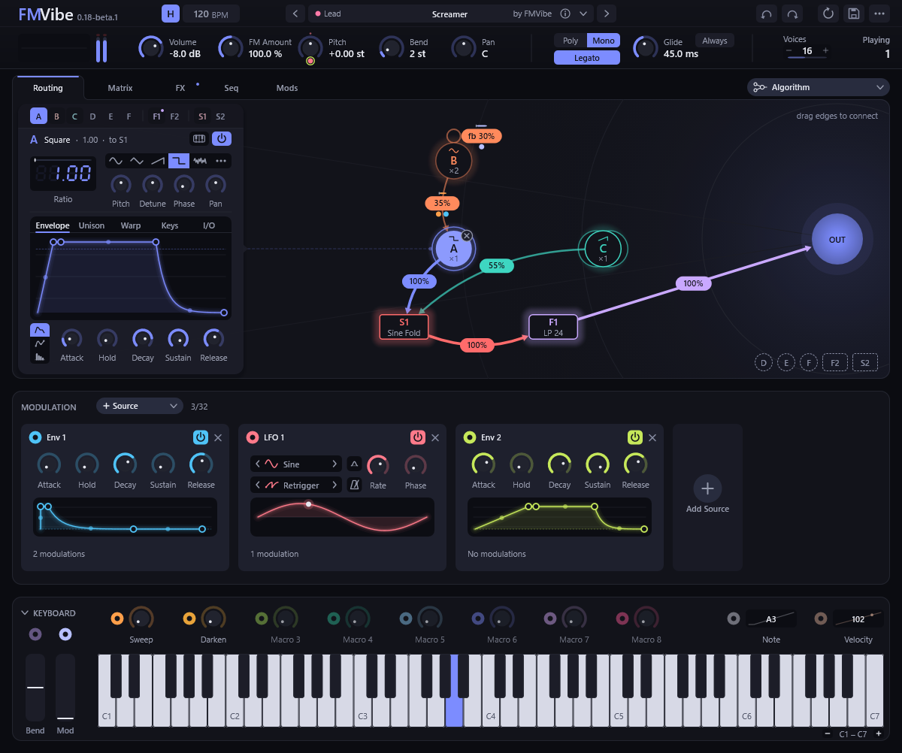
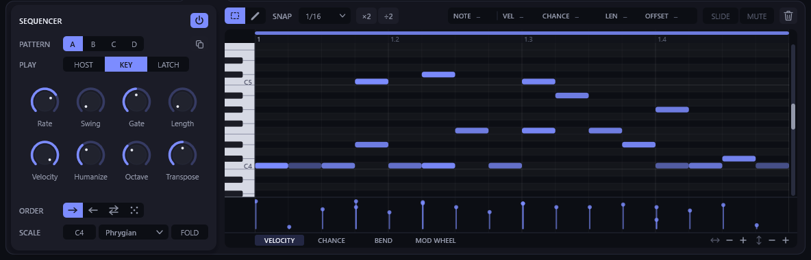
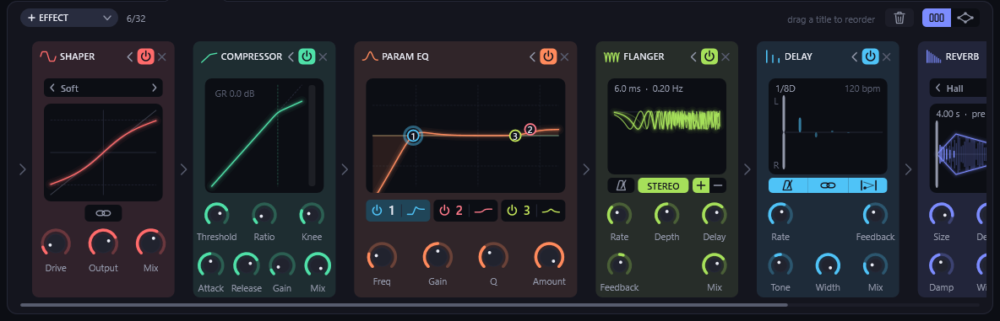
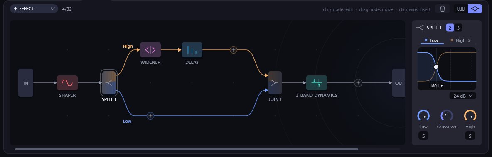

# FMVibe

A six-operator FM synthesizer as a [CLAP](https://github.com/free-audio/clap) and a
[VST3](https://github.com/steinbergmedia/vst3sdk) instrument plugin for Windows and Linux. It works in the spirit of
other popular FM synths.

- 6-operator FM with free routing
- Easy modulation with drag and drop, even at audio rate
- 17 audio effects as a chain or a multiband graph
- Step sequencer with macro automation and per-note bends
- DX7 sysex import
- MPE and microtuning (MTS-ESP, Scala)

In-browser demo: [https://pcdlin.github.io/FMVibe/](https://pcdlin.github.io/FMVibe/)

User manual: [https://pcdlin.github.io/FMVibe/manual.html](https://pcdlin.github.io/FMVibe/manual.html)

Implemented using Claude Code.

<table>
  <tr>
    <td align="center" valign="top" width="50%">
      <a href="docs/editor.png"></a><br>
      Main UI
    </td>
    <td align="center" valign="top" width="50%">
      <a href="docs/seq.png"></a><br>
      Sequencer
    </td>
  </tr>
  <tr>
    <td align="center" valign="top" width="50%">
      <a href="docs/fx-chain.png"></a><br>
      FX chain
    </td>
    <td align="center" valign="top" width="50%">
      <a href="docs/fx-graph.png"></a><br>
      FX graph
    </td>
  </tr>
</table>

Click a screenshot to see it full size.

## Download

Each [release](https://github.com/pcdlin/FMVibe/releases) has two zips for 64-bit Windows, one per format:
`FMVibe-v<version>-windows-x64-clap.zip` holds `FMVibe.clap`, and `FMVibe-v<version>-windows-x64-vst3.zip` the
`FMVibe.vst3` folder, and both hold the user manual, `FMVibe-Manual.html`. Download whichever your DAW takes, or both.

- Put `FMVibe.clap` into either the per-user CLAP folder, `%LOCALAPPDATA%\Programs\Common\CLAP`, or the system-wide
  one, `%COMMONPROGRAMFILES%\CLAP`.
- Put the whole `FMVibe.vst3` folder into either the per-user VST3 folder, `%LOCALAPPDATA%\Programs\Common\VST3`,
  or the system-wide one, `%COMMONPROGRAMFILES%\VST3`. Not every DAW looks in the per-user one; if yours doesn't,
  use the system-wide one or add the folder to the DAW's plugin folders.

Copying into a system-wide folder needs administrator rights.

For 64-bit Linux, each release also has two tarballs, `FMVibe-v<version>-linux-x64-clap.tar.gz` and
`FMVibe-v<version>-linux-x64-vst3.tar.gz`, built on Ubuntu 24.04 (they require a distribution about as new). Each
unpacks into a folder of its name: put `FMVibe.clap` from it into `~/.clap` and the whole `FMVibe.vst3` folder into
`~/.vst3`.

## Build

Requirements:

- Visual Studio 2026 with the *Desktop development with C++* workload (includes CMake and Ninja).
- Internet access on the first configure: CMake fetches the CLAP SDK, the VST3 SDK and clap-validator.

```powershell
.\build.ps1                    # release: configure, build, tests
.\build.ps1 -Config debug      # debug build in build\debug
.\build.ps1 -Validate          # also run clap-validator and Steinberg's VST3 validator
.\build.ps1 -Install           # also install the plugins into the per-user CLAP and VST3 folders
.\build.ps1 -Install -SkipTests  # build only the plugins and install them
.\build.ps1 -Install -Format vst3 -SkipTests  # one format only (or -Format clap)
```

`build.ps1` sets up the Visual Studio environment itself and runs from any PowerShell window. Output goes to
`build\<config>\FMVibe.clap` and `build\<config>\FMVibe.vst3`. Once it has run in a session, plain CMake works too:

```powershell
cmake --preset release
cmake --build --preset release
ctest --preset release
cmake --build --preset release --target validate
cmake --install build\release
```

To try the plugin without a DAW, run `build\<config>\fmvibe-uihost.exe` (or `.\build.ps1 -Run -SkipTests`). It opens
the editor in a window and plays through the default output device; notes come from the editor's keyboard, the computer
keyboard (A W S E D … from middle C, Z/X for the octave, C/V for the velocity) and any MIDI input.

On Linux, `./build.sh` builds the CLAP and VST3 plugins (`FMVibe.clap` and the `FMVibe.vst3` bundle), the audio
quality test, the editor's snapshots (PNGs in `build/linux/ui-shots`), a small test host and Steinberg's VST3
validator, then runs the tests.
`./build.sh --install` also puts them in `~/.clap` and `~/.vst3`. It needs CMake 3.25+, Ninja, a C++20 compiler (GCC 13
or Clang 18), `pkg-config`, Cairo and X11:

```bash
sudo apt-get install -y cmake ninja-build g++ pkg-config git libcairo2-dev libx11-dev fonts-inter
./build.sh --install
```

The editor is an X11 window (XWayland included) drawn through Cairo; it links no GTK and no Wayland, and asks the
desktop for its file and warning dialogs (`zenity`, else `kdialog`) as separate programs, so nothing but X11, Cairo and
fontconfig is loaded into the DAW. See [AGENTS.md](AGENTS.md#linux-development-build).

## Documentation

The manual's source is [docs/manual.md](docs/manual.md), and the full feature reference is in
[docs/features.md](docs/features.md).
Information about working on the code, its tests and the plugin's internals are in [AGENTS.md](AGENTS.md).

## Contributions

- Linux support by [@efthymik](https://github.com/efthymik)

## License

FMVibe is released under the [MIT license](LICENSE).
