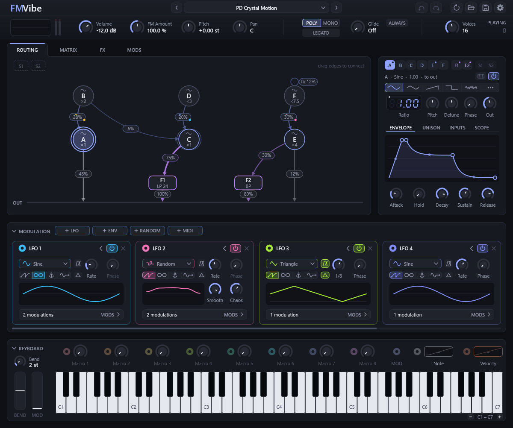

# FMVibe

A six-operator FM synthesizer as a [CLAP](https://github.com/free-audio/clap) and a
[VST3](https://github.com/steinbergmedia/vst3sdk) instrument plugin for Windows. It works in the spirit of other
popular FM synths.

In-browser demo: [https://pcdlin.github.io/FMVibe/](https://pcdlin.github.io/FMVibe/)



Implemented using Claude Code.

The full feature reference is in [docs/features.md](docs/features.md).
Information about working on the code, its tests and the plugin's internals are in [AGENTS.md](AGENTS.md).

## Download

Each [release](https://github.com/pcdlin/FMVibe/releases) has a zip for 64-bit Windows with `FMVibe.clap` and the
`FMVibe.vst3` folder; use whichever your DAW takes, or both.

- Put `FMVibe.clap` into either the per-user CLAP folder, `%LOCALAPPDATA%\Programs\Common\CLAP`, or the system-wide
  one, `%COMMONPROGRAMFILES%\CLAP`.
- Put the whole `FMVibe.vst3` folder into either the per-user VST3 folder, `%LOCALAPPDATA%\Programs\Common\VST3`,
  or the system-wide one, `%COMMONPROGRAMFILES%\VST3`. Not every DAW looks in the per-user one; if yours doesn't,
  use the system-wide one or add the folder to the DAW's plugin folders.

Copying into a system-wide folder needs administrator rights.

## Build

Requirements:

- Visual Studio 2026 with the *Desktop development with C++* workload (includes CMake and Ninja).
- Internet access on the first configure: CMake fetches the CLAP SDK, the VST3 SDK and clap-validator.

```powershell
.\build.ps1                    # release: configure, build, tests
.\build.ps1 -Config debug      # debug build in build\debug
.\build.ps1 -Validate          # also run clap-validator and Steinberg's VST3 validator
.\build.ps1 -Install           # also install the plugins into the per-user CLAP and VST3 folders
.\build.ps1 -Install -SkipTests  # build only the plugins and install them
.\build.ps1 -Install -Format vst3 -SkipTests  # one format only (or -Format clap)
```

`build.ps1` sets up the Visual Studio environment itself and runs from any PowerShell window. Output goes to
`build\<config>\FMVibe.clap` and `build\<config>\FMVibe.vst3`. Once it has run in a session, plain CMake works too:

```powershell
cmake --preset release
cmake --build --preset release
ctest --preset release
cmake --build --preset release --target validate
cmake --install build\release
```

The folder also opens in Visual Studio or VS Code (CMake Tools), which pick up the `debug` and `release` presets from
`CMakePresets.json`.

To try the plugin without a DAW, run `build\<config>\fmvibe-uihost.exe` (or `.\build.ps1 -Run -SkipTests`). It opens
the editor in a window and plays through the default output device; notes come from the editor's keyboard, the computer
keyboard (A W S E D … from middle C, Z/X for the octave, C/V for the velocity) and any MIDI input.

## License

FMVibe is released under the [MIT license](LICENSE).
