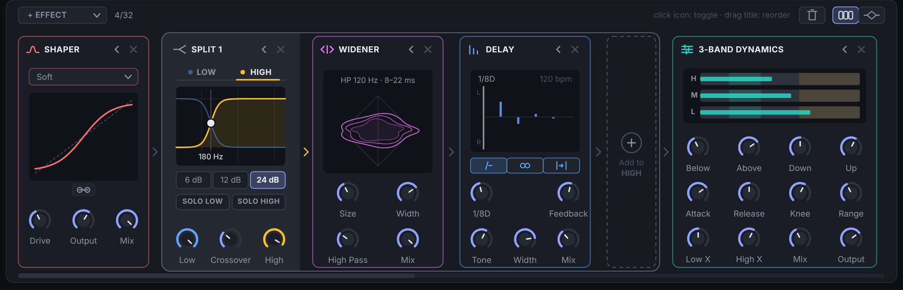
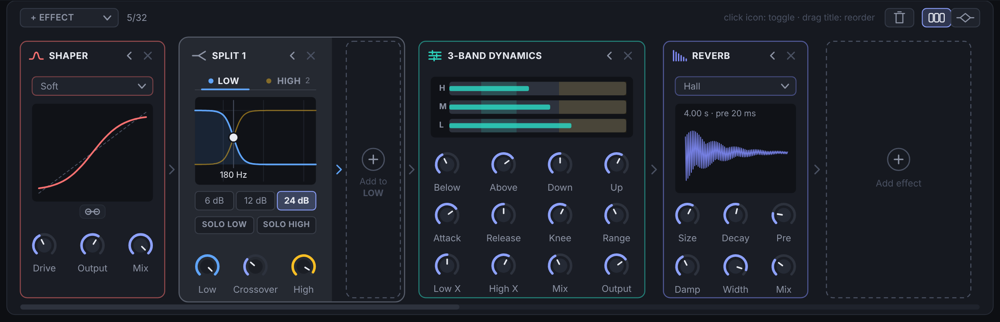
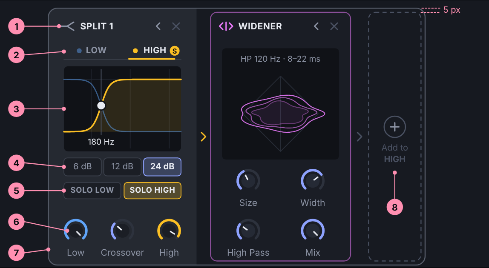
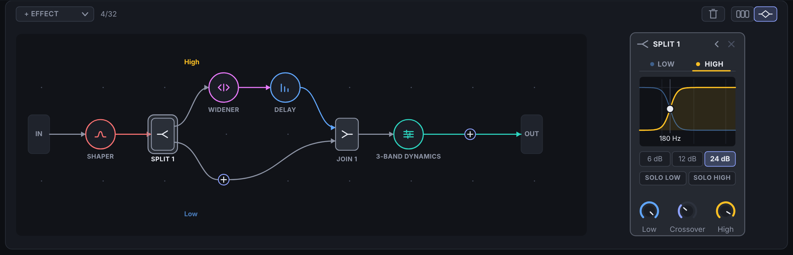
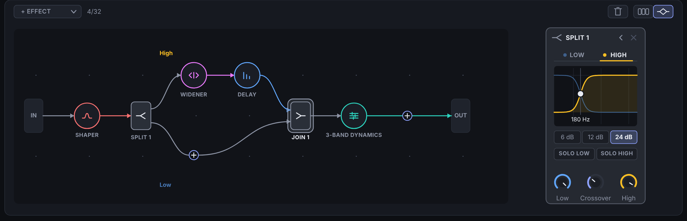
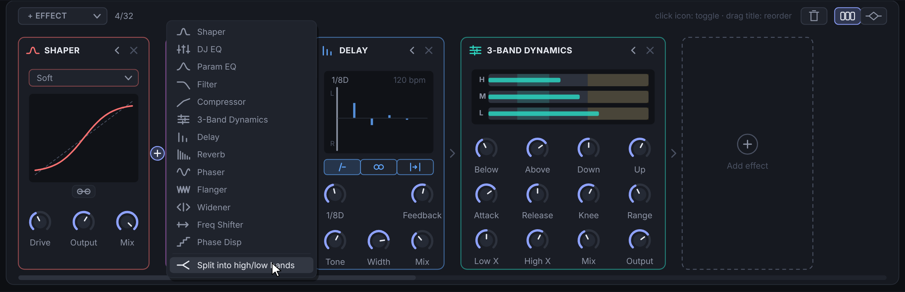
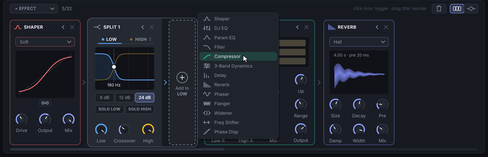
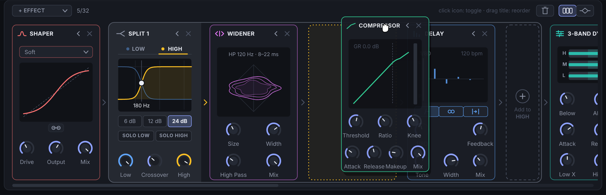

# Draft: the frequency split as a container card in the FX chain

UI drafts only, nothing implemented. They build on PR #37 (the effects graph with frequency splits). Open
`index.html` in a browser for the full write-up: the anatomy, how the container maps onto the graph, the flows,
an implementation note (one data model, two views) and open questions. The PNGs are its mockups, rendered at 2x.

| | |
| --- | --- |
|  | 1. The high band shown |
|  | 2. The low band shown (empty) |
|  | 3. Anatomy of the container |
|  | 4a. Graph view, the split picked: the same controls as a card |
|  | 4b. Graph view, the join picked: the same card |
|  | 5. Adding a split from the chain |
|  | 6. Adding an effect to a band |
|  | 7. Dragging a card into a band |
