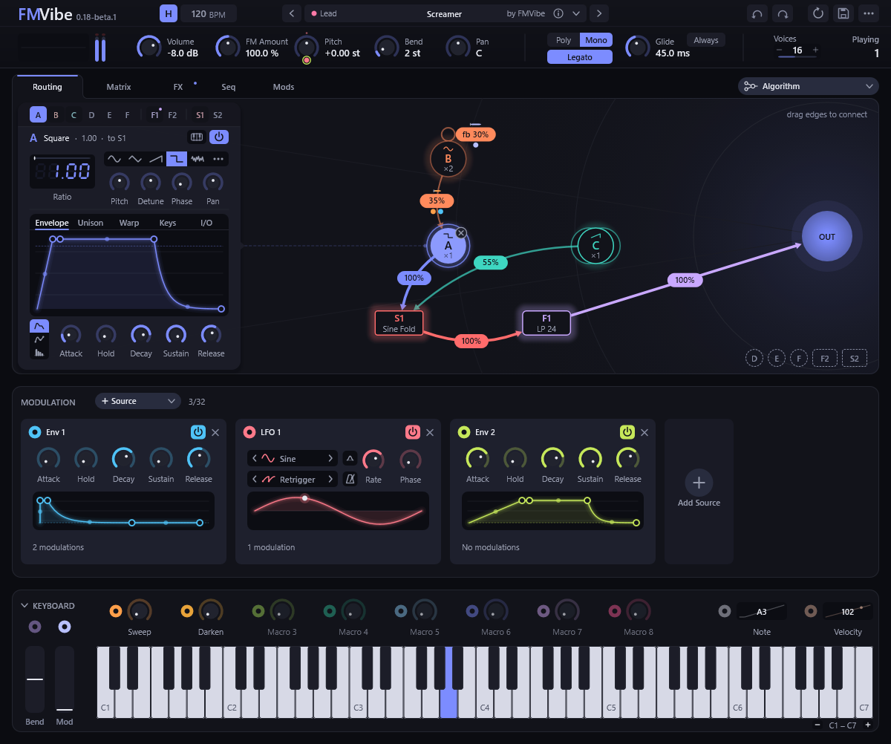
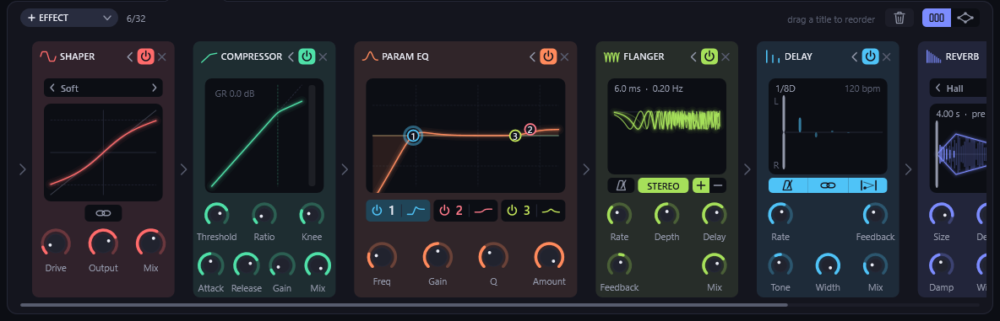
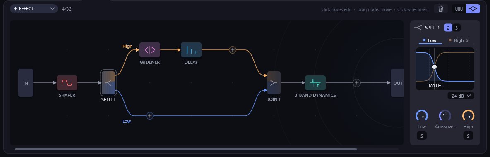
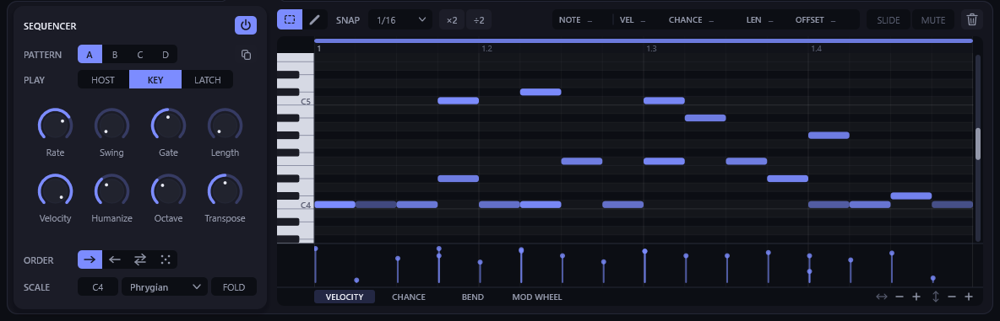

# FMVibe User Manual

FMVibe is a six-operator FM synthesizer for Windows and Linux, available as a CLAP and a VST3 instrument plugin. This
manual explains how to use it. It assumes you are familiar with your DAW and with basic synthesis terms such as
oscillators, envelopes, LFOs and filters.

## Contents

1. [Introduction](#1-introduction)
2. [Installation](#2-installation)
3. [How FMVibe makes sound](#3-how-fmvibe-makes-sound)
4. [The plugin window at a glance](#4-the-plugin-window-at-a-glance)
5. [Header](#5-header)
6. [Operators](#6-operators)
7. [Routing](#7-routing)
8. [Filters](#8-filters)
9. [Shapers](#9-shapers)
10. [Modulation](#10-modulation)
11. [Effects](#11-effects)
12. [Sequencer](#12-sequencer)
13. [Playing FMVibe](#13-playing-fmvibe)
14. [Presets](#14-presets)
15. [Settings](#15-settings)
16. [Working with the plugin](#16-working-with-the-plugin)
17. [FMVibe in your DAW](#17-fmvibe-in-your-daw)
18. [Keyboard and mouse reference](#18-keyboard-and-mouse-reference)

---

## 1. Introduction

FMVibe works in the spirit of classic and modern FM synthesizers. Its main features:

- **Six operators** (A–F) with a wide choice of waveforms, including custom drawn waves of up to 64 partials,
  unison of up to 16 copies, phase warps, and fixed-frequency mode.
- **Free routing**: any operator can modulate any other, itself included, in four route modes (Phase, Linear FM,
  Exp FM and Ring). Routes can be edited as a graph or a matrix, or set from one of the classic FM algorithms.
- **Two filters and two shapers per voice**, which can be placed anywhere in the routing, fed back into themselves
  and each other, and used as modulators.
- **Flexible modulation**: up to 32 sources (LFOs, envelopes, drawn curves, random and MIDI sources), plus eight
  macros, the mod wheel, pitch bend, note pitch, velocity and the operators' outputs, which also give filter FM. Each
  modulation has its own depth, curve, amount and an optional auxiliary source that scales it.
- **Effects**: up to 32 effects from 17 types, in a chain that can be split into frequency bands.
- **A step sequencer** with a piano roll, four patterns per preset and automation curves.
- **Presets** with a browser, categories, favorites and search, and a library of factory presets.
- MPE support, CLAP per-voice modulation, and a resizable UI with four themes.

An in-browser demo with the factory presets is available at
[pcdlin.github.io/FMVibe](https://pcdlin.github.io/FMVibe/).

## 2. Installation

Each release offers two zip files for 64-bit Windows, one per plugin format. Download whichever your DAW supports,
or both.

- **CLAP**: copy `FMVibe.clap` into `%LOCALAPPDATA%\Programs\Common\CLAP` (for your user only) or
  `%COMMONPROGRAMFILES%\CLAP` (for all users).
- **VST3**: copy the whole `FMVibe.vst3` folder into `%LOCALAPPDATA%\Programs\Common\VST3` or
  `%COMMONPROGRAMFILES%\VST3`. Not every DAW scans the per-user folder; if yours doesn't, use the system-wide folder
  or add the folder to your DAW's plugin paths.

Copying into a system-wide folder requires administrator rights. FMVibe needs no runtime libraries beyond Windows
itself.

The CLAP and VST3 versions share the same engine, plugin window, parameters and presets, and a preset file loads in
either. Your DAW treats them as two different plugins, however, so a project made with the CLAP version won't open the
VST3 version in its place, or the other way round.

For 64-bit Linux, each release also offers two `.tar.gz` files, one per format; both plugins also build from source (`./build.sh`; see the README). 
Copy `FMVibe.clap` into `~/.clap` and the whole `FMVibe.vst3` folder into `~/.vst3` (`./build.sh --install` does both). 
Presets live in `~/.local/share/FMVibe/presets` and settings in `~/.config/FMVibe`, or the XDG equivalents where set.

## 3. How FMVibe makes sound

### Signal flow

Each note you play gets a **voice**. Inside a voice:

```
  One voice:
    Operators A–F  ◄──►  Filters F1, F2  ◄──►  Shapers S1, S2
         │                     │                     │
         └─────────────────────┼─────────────────────┘
                               ▼
                              OUT
                               │
  All voices summed ───────────┘
                               ▼
                 Effects (up to 32, with splits)
                               ▼
                       Volume ──► output
```

- **Operators** are the oscillators. An operator that is sent to the output is a *carrier*; one that only
  modulates another operator is a *modulator*. Any operator can be both.
- **Routes** connect the nodes of a voice: an operator into another operator (FM), into a filter or a shaper, and
  any of these to **OUT**. Filters and shapers can also modulate operators and feed each other.
- **OUT** collects what every node sends to the output. All voices are then summed and pass through the
  **effects**, which are shared by all voices, and finally the **Volume** control.

### What a new instance contains

A new instance starts with a simple patch: only operator A is switched on, playing a sine at the note's pitch,
straight to the output. The other operators are off, both filters and both shapers are off, there are no modulation
sources and no effects. Building a patch means switching nodes on, connecting them and adding sources and effects.

### Modulation in brief

Modulation **sources** (LFOs, envelopes, macros and so on) each have up to 16 **slots**. A slot connects the source
to a **target**: almost any continuous control, including route amounts, effect knobs, other sources' rates and even
other modulations' depths. You assign modulation by dragging a source's colored **handle** onto a control. See
[Modulation](#10-modulation).

## 4. The plugin window at a glance



From top to bottom, the plugin window has:

- The **header**: a title bar with the preset bar and file buttons, and the global strip with the output scope,
  meter, global knobs and play controls.
- The **view tabs**: **Routing**, **Matrix**, **FX**, **Seq** and **Mods**, which choose what the main panel shows.
  While Routing or Matrix is shown, an **Algorithm** button sits at the right end of the row.
- The **main panel**. In Routing and Matrix it shows the routing graph or matrix, with the **inspector** floating
  over its left end. FX, Seq and Mods use the whole panel. At full size, Seq also covers the modulation panel, for a
  taller piano roll.
- The **modulation panel**: the source cards.
- The **keyboard strip**: macros, the note and velocity sources, the pitch and mod wheels and a six-octave keyboard.

The plugin window can be resized and keeps its aspect ratio. It opens and unfolds within the screen's work area: a
saved or last-used size that no longer fits, or the taller layout when the keyboard strip unfolds, is scaled down
rather than run past the screen. The keyboard strip can be collapsed to its title row, which makes the plugin window
shorter.

Tabs use two small marks in their top-right corner, with the same meaning everywhere:

- A **filled dot** means what the tab shows is on and you hear it: FX while an effect is switched on, Seq while the
  sequencer is on, and a node's tab in the inspector while the node is sent to the output.
- A **ring** means a control on that tab is being modulated, like the ring on a modulated knob. It shows whether
  the tab is open or not, so you can spot modulation on a tab you aren't looking at.

## 5. Header

### Title bar

From left to right:

- **Tempo** (only in hosts that let the plugin set the tempo, such as the browser demo): see [Tempo](#tempo).
- The **preset bar**: the current preset's category, name and author, arrows to step through presets and an
  **(i)** button for the preset's info card. See [Presets](#14-presets).
- **Undo** and **Redo** (curved arrows). Hovering one shows what it would undo or redo.
- **Init**, **Load**, **Save** (a disk) and **Save As** (a disk with a plus).
- The **settings** cog. See [Settings](#15-settings).

### Tempo

The tempo field in the title bar shows the tempo that synced LFOs, delays, sweeps and the sequencer follow, in
BPM. The **H** button at its left syncs to the host tempo:

- **H on** (the default): FMVibe plays at the host's tempo. The field shows it dimmed; change the tempo in the host.
- **H off**: FMVibe plays at its own tempo (140 BPM to begin with), whatever the host's. Set it in the field:
  - Drag up or down to change the tempo (in 0.1 BPM increments when holding Shift).
  - Use the mouse wheel to step it by 1 BPM (in 0.1 BPM increments when holding Shift).
  - Double-click or Ctrl+click to type a value, from 20 to 999.

The H and FMVibe's own tempo are saved with your project, not with presets, and undo leaves them alone.

Every preset remembers the tempo it was saved at. Loading it sets FMVibe's own tempo to it, so with H off a sequencer
pattern plays as it was made. In a DAW, loading a preset never changes the host's tempo.

The browser demo has no H button: it always plays at its own tempo, which you set in the field.

### Global strip

- **Output scope**: the output waveform, synced to the most recent note so it stands still. It scales automatically
  so the shape is visible at any volume.
- **Output meter**: peak level for each side, from −48 dB to full scale. A light above the meter turns red for a moment
  if the output clips.
- **Volume**: the output level after the effects, −60 to +12 dB (−12 dB by default).
- **FM Amount**: scales every route in the routing at once, a quick way to make a patch duller or brighter.
- **Pitch**: transposes the whole instrument by up to ±48 semitones. A useful envelope target for drums.
- **Bend**: the pitch bend range in semitones for MIDI pitch bend and the Bend wheel. It can't be modulated.
- **Pan**: the stereo position of the whole instrument.
- **Poly | Mono**, **Legato**, **Glide** and **Always**: the play modes. See [Play modes](#play-modes).
- **Voices**: the polyphony limit, 1–512 (16 by default), with the number of voices playing beside it.

## 6. Operators

Select an operator by clicking its node in the routing graph, its name in the matrix, or its tab (**A**–**F**) at
the top of the inspector. The inspector then shows its page.

### The inspector

The inspector has a tab for each node: operators A–F, filters F1 and F2, and shapers S1 and S2.

- Tabs of switched-off nodes are dimmed; clicking one switches the node on.
- Clicking the selected tab switches its node off, or on again. The power switch on the page's title line does the
  same.
- A dot in a tab's corner means the node is sent to the output (see [the tabs' marks](#4-the-plugin-window-at-a-glance)).

Under the tabs, the page title shows the node's letter and a **summary line**, for example
`A Saw · 1.20 · ×4 · to F1`: the wave, ratio, unison copies and destinations. On an operator's page, the letter is
its modulation handle (see [Operators as sources](#operators-as-sources)). While a node is off, its page is dimmed,
but its controls still work.

A switched-off operator is silent and uses no CPU, but keeps its settings and connections.

### Waves

The wave buttons at the top right of the page select the operator's waveform:

| Wave | Description |
| --- | --- |
| Sine, Triangle, Saw, Square | The standard waveforms. |
| Noise | Noise with no pitch. See [Noise operators](#noise-operators). |
| **…** menu: | |
| Pulse | A 25 % pulse. |
| Half Sine | The positive half of a sine, as on classic FM chips. |
| Abs Sine | A rectified sine, sounding an octave up. |
| Alt Sine | A full sine in the first half of the cycle, then silence; a strong 2nd harmonic. |
| Organ | Drawbars 8', 4', 2 2/3', 2', 1 1/3' and 1'. |
| Vowel | A buzzy "ah" whose color shifts with the note's pitch. |
| Custom | A wave you draw from its partials. See [Custom waves](#custom-waves). |

### Ratio

The **Ratio** readout sets the operator's frequency as a multiple of the note, from 0.50 to 64.00 in steps of
0.01. It works like a four-digit display where each digit is its own control:

- Drag a digit up or down to change it by its own place value (10, 1, 0.1 or 0.01).
  Hold Shift for finer steps.
- Use the mouse wheel over a digit to step it.
- Double-click a digit to reset it and the digits to its right.
- Ctrl+click (or **Edit value…** in the right-click menu) to type a value, including fractions such as `7/2`.

A track above the digits shows the ratio and the reach of any modulation on it. Modulation can take the ratio up
to 128.

### Fixed pitch

The small **keyboard icon** on the summary line switches the operator to a **fixed frequency** that ignores the
note. **Freq** (1 Hz–2 kHz) and **Mult** (×0.001, ×0.01, ×0.1, ×1 or ×10) then replace the Ratio readout.

When you switch it on, Freq and Mult are set to the frequency the operator was playing for an A4. A fixed operator
ignores the note, pitch bend, glide, the global Pitch, and its own Ratio, Pitch and Detune (which are dimmed). Freq can
be modulated.

### Pitch, Detune, Phase and Pan

- **Pitch**: transposes the operator by ±48 semitones.
- **Detune**: ±50 cents.
- **Phase**: where the waveform starts, 0–100 % of a cycle. It can be turned or modulated while notes play,
  without clicks.
- **Pan**: places the operator's output, L100 to R100. It applies to what the operator sends to the output, filters and
  shapers. Other operators receive a modulator in mono, so a modulator's Pan only matters if it is also sent to the
  output.

Velocity does not affect operators directly. Assign the **Velocity** source to an operator's Out (or anything
else) to make it velocity-sensitive.

### Envelope tab

Below the main controls, a set of tabs selects what the lower part of the page shows.

**Envelope** shows the operator's amplitude envelope (AHDSR) with its knobs. By default it is an organ-like gate:
instant attack, full sustain and a 15 ms release.

- **Attack**, **Decay** and **Release**: 0 ms to 10 s. A 0 ms attack starts the note at full level.
- **Hold**: keeps the level at its peak for a while after the attack (Off by default).
- **Sustain**: the level held while the key is down.
- **Curves**: the attack, decay and release can each be bent from −100 % (slow start, fast end) through 0
  (straight) to +100 % (fast start, slow settle). Decay and release default to +50 %.

On the display, drag the handles for the peak, the end of the hold, the sustain level and the end of the release.
Drag the small dot halfway along a segment up or down to bend it; double-click it to straighten it.

The display zooms to fit the whole envelope. While notes play, a dashed line and a dot show the most recent voice's envelope level and position.

### Unison tab

**Unison** sets how many copies of the operator play (up to 16) and how they spread:

- **Unison**: the number of copies.
- **Detune**: spreads the copies in pitch, up to ±200 cents for the outermost ones.
- **Spread**: spreads them across the stereo field.
- **Blend**: turns the outer copies down relative to the middle one, keeping the overall level. Useful for a strong
  center with a quiet halo, also on modulators.
- **Rnd Phase**: randomizes where each copy starts its cycle; at 0 % every note starts the same way.

The buttons along the display choose the **Unison Curve**, how copies are placed in pitch:

- **Linear**: evenly spaced.
- **Center**: bunched toward the middle.
- **Supersaw**: unevenly spaced, as in a classic supersaw, with an outer pair far out.
- **Random**: copies spread at random across the detune range, chosen per note.

and the **Unison Pan**, how they are placed in stereo:

- **Ramp**: left to right as their pitch rises.
- **Alternate** (default): neighboring copies alternate left and right, for a wide image with any number of copies.
- **Random**: the stereo positions randomly chosen per note.

The display shows each copy's position (left/right by spread, up/down by detune), each drawn as loud as Blend leaves it.
In the routing graph, an operator with unison is drawn as a stack of rings.

### Warp tab

**Warp** shows a scope of the operator and provides phase warp and hard sync functions.

The **scope** shows the operator's output in the most recent voice, with its FM, envelope and modulation. The trace
stands still even under heavy FM. The **1 / 2 / 4** buttons choose how many cycles are shown. With no note
playing, the plain wave is drawn faintly, with the warped or synced wave over it.

The **warp** buttons choose how the operator's waveform is reshaped, and **Amount**
(−100 to +100 %) sets how strongly:

| Warp | Effect |
| --- | --- |
| Off | The plain wave (default). |
| Bend | Rushes through the start of the cycle and lingers at the end (reversed below 0), like phase distortion bending a sine toward a saw. |
| Squeeze | Compresses the first half of the cycle and stretches the second: pulse-width modulation for a square, a leaning sine or saw. |
| Pulse | Plays the whole cycle at its start and stays flat for the remainder (reversed below 0). |
| Steps | Quantizes the cycle into 8 steps (4 below 0). |
| Sync | Plays the wave up to 16 times per cycle, cut off at the cycle's end: the formant rises with the amount while the pitch stays. |

Amount can be modulated, for example an LFO on Squeeze for PWM. Changing
warps never clicks.

The **note** button (an eighth note) switches on **Note Sync** (hard sync to the note). Each cycle of the note's pitch restarts the operator's
wave, so the operator's ratio sets the timbre while the pitch stays on the note. Sweep the ratio with an envelope or
LFO for the classic sync sweep. Any operator can sync, carriers and modulators alike. Warp and Note Sync can be
combined.

The summary line names the warp and says "note sync" while either is active.

### Inputs tab

**Inputs** lists every node routed into the operator, one row each:

- the node's name (click it to show that node);
- four buttons for the route's **mode** (Phase, Linear FM, Exp FM, Ring), with the active one lit;
- the route's depth, which you can drag, type and modulate like a wire label in the graph.

The operator's feedback comes last and is always Phase.

A tab whose controls are being modulated shows a ring in its corner. While you drag a modulation source's handle, holding it
over a tab for half a second opens that tab, so you can drop the handle on its controls.

### Noise operators

With the Noise wave, the Ratio readout is replaced by:

- **Slope**: moves the noise from white through pink (−3 dB per octave) to brown (−6 dB per octave) at roughly the
  same loudness.
- **Spread**: widens it from mono to fully uncorrelated left and right.

Noise has no Pitch, Detune, Phase, unison or warp. Its first tab is **Spectrum**, which shows its spectrum against
white, pink and brown noise.

### Custom waves

Choosing **Custom** from the **…** menu builds the wave from its partials (harmonics) and opens the **partial
editor** over the routing panel. It shows one cycle of the resulting wave and two bars per partial: its **level**
(−60 to 0 dB, or none at the bottom) and, in another color, its **phase**.

- Drag across the bars to draw them; double-click a bar to silence it.
- **16 / 32 / 64** sets how many partials the wave uses (32 by default). Partials hidden by a lower count keep their
  settings.
- The **die** gives all 64 partials random levels that get quieter toward the higher partials, and random phases.
- The **reset** button (circular arrow) returns to a sine.
- The **check mark**, or any view tab, closes the editor.

If you pick Custom after another wave, the partials start out matching that wave. While the wave is Custom, a **pencil**
button on the operator's summary line opens the partial editor again.

## 7. Routing

The **Routing** and **Matrix** tabs show the same connections in two ways: as a graph, which shows only the nodes
that are on, or as a grid, which lists every node.

### The routing graph

- **Operators** are circles showing their wave and ratio (or frequency, when fixed). **Filters** are rounded boxes
  showing their type, and **shapers** are squarer boxes showing their curve.
- Each node is outlined in its own color: fully while it reaches the output, faintly while it doesn't.
- **OUT** is the disc at the right. It glows with the level of what the nodes send to the output. Sounding nodes
  glow too, as brightly as they sound.
- Switched-off nodes wait as dashed ghosts below OUT. Click one to switch it on.

**Connecting**: drag from a node's **edge** (a band around its outline, which glows under the mouse) onto:

- an operator, to modulate it;
- a filter or shaper, to send into it;
- **OUT**, to send it to the output;
- the node itself, for feedback.

Dragging from inside a node moves it; a click selects it.

**Moving connections**:

- Drag a wire's **arrowhead** onto another node to move the route there, keeping its amount and modulation. Drop
  it in empty space to remove the route.
- Drag a wire's **start** onto another node to make the route come from there instead.
- A line to OUT works the same way: drag its arrowhead onto a node to route it there instead, or its start onto
  another node to send that one out instead.
- Dragging the arrowhead of a node's line to OUT onto a filter or shaper the node already feeds routes the node
  through it instead of adding a second path.

**Amounts**: each wire and each line to OUT has a percentage label.

- Drag the label up or down to set the depth.
- Ctrl+click it (or **Edit value…** in its right-click menu) to type a value.
- Double-click it to remove the route.
- Hovering the label expands it to show an **×** that removes the route and, for routes into an operator,
  the route **mode** with a list.

A route turned down to 0 % stays in place, so you can still drop modulation on it; only removing it takes it away,
together with its modulation.

**Shaping the graph**:

- Drag nodes to rearrange them. Hold **Ctrl** while dragging to snap a node to a grid.
- Drag a wire sideways to bend it, so wires don't overlap. Double-click a wire, or choose **Reset Bend**, to restore
  its original curve. Lines to OUT can be bent the same way.

**Switching nodes on and off**: use the inspector's tabs, the **×** in a circle at a node's upper right (visible
under the mouse), or the node's right-click menu.

A modulated wire swells and thins with its modulation while notes play.

### Route modes

Every route into an operator works in one of four modes (Phase by default):

| Mode | Effect |
| --- | --- |
| **Phase** | Classic FM, as on most FM synths. The note stays in tune at any depth. |
| **Linear FM** | Modulates the operator's frequency directly. The note stays in tune even at deep settings. |
| **Exp FM** | Modulates the operator's pitch in octaves, like the FM input of an analog synth (up to 4 octaves at 100 %). Deeper settings pull the pitch upward. |
| **Ring** | Multiplies the operator's output by the source. At 100 % you hear only the sum and difference frequencies; at 50 % they are mixed with the original tone (amplitude modulation). |

Set the mode from a wire's label, the right-click menu of a wire or matrix cell, or the operator's Inputs tab. Feedback
is always Phase. Route amounts give finer control at low settings, and **FM Amount** scales all of them.

### Feedback and loops

Feedback (a node into itself) and loops between nodes are allowed everywhere: operators, filters and shapers alike.
Loops can get loud but never grow without limit, and they fade out after a note is released.

### The matrix

The **Matrix** view is a grid: each row is a source (operator, filter or shaper) and each column a destination (the
six operators, F1, F2, S1, S2 and OUT). The diagonal is each node's feedback.

- Drag a cell up or down to set its amount.
- Double-click a cell to switch the route on or off (feedback starts at 25 %).
- Ctrl+click a cell to type an amount.
- Right-click a cell for its route mode.

Rows and columns of switched-off nodes are greyed out; editing a cell switches on the nodes it joins. Clicking a
row's or column's name shows that node in the inspector, switching it on if needed.

### Algorithms

**Algorithm**, at the right of the tab row, opens a panel of the classic FM algorithms. The **Operators** switch in
its title row chooses the set:

- **6**: the 32 classic six-operator algorithms, numbered as on the classic charts.
- **4**: the 8 classic four-operator algorithms (operators A–D).
- **3**: the 5 shapes three operators can take.
- **2**: the two-operator pair.

Each thumbnail shows modulators on the left and carriers on the right, with feedback as a small loop. The algorithm your
operators currently form is highlighted, and its number shows on the button.

Clicking an algorithm, as one undo step:

- switches on the operators it uses and switches the others off (their settings are kept);
- keeps routes that it shares with your patch, adds its other routes at 50 % (feedback at 25 %) and removes routes
  among its operators that it doesn't use;
- sends its carriers to the output (new carriers at a balanced level) and takes the modulators off it;
- lays out the operators in the graph.

Filters, shapers, their routes and every operator's own sound (wave, ratio, envelope, unison) stay as they are.
Escape or a click outside closes the panel without a change.

## 8. Filters

Each voice has two filters, **F1** and **F2**, both off in a new instance. Switch one on with its inspector tab,
route something into it, and route it to OUT.

### Routing filters

- Any operator or shaper can be sent into either filter.
- **F1 → F2** gives a series chain; F2 can also feed F1, and each filter can feed itself.
- Filters can feed the shapers.
- A filter's output can **modulate operators**, just like an operator. Noise through a band-pass into a carrier,
  for example, adds a narrow band of grit.
- A filter that only modulates doesn't need to be routed to OUT.

### Filter types

The type list offers seven types: **Low-pass**, **High-pass**, **Band-pass**, **Notch**, **Comb**, **Formant** and
**Morph**. Low-pass, high-pass and band-pass each come in several models, which you pick from the **Model** list beside
the slope list, under the response display. Its **‹** and **›** arrows step through the models, so you can hear each in
turn. When you pick another type, the filter keeps its model if the new type has it: a ladder low-pass becomes a ladder
high-pass.

| Type | Models |
| --- | --- |
| Low-pass | **SVF**, **Ladder**, **Diode**, **Sallen-Key** |
| High-pass | **SVF**, **Ladder**, **Sallen-Key** |
| Band-pass | **SVF**, **Ladder** |
| Notch, Comb, Formant, Morph | One model each, so no Model list |

| Type or model | Description |
| --- | --- |
| SVF (low-pass, high-pass, band-pass), Notch | The clean, classic filters. Slope 6, 12 (default), 18 or 24 dB/octave; band-pass and notch offer 12 and 24 only. |
| Comb | A tuned feedback delay: Cutoff sets the pitch, Resonance the feedback. |
| Ladder low-pass | A four-pole transistor ladder with saturating stages. Slope picks 6 to 24 dB (one to four stages). Resonance thins the low end; it self-oscillates at high resonance. |
| Ladder high-pass | The same ladder built from high-pass stages. Slope picks 6 to 24 dB. Resonance thins the top end; it self-oscillates at high resonance. |
| Ladder band-pass | A ladder that rings at its center, 12 or 24 dB. It self-oscillates at high resonance, louder than the low-pass ladder. |
| Diode low-pass | A four-pole diode ladder: darker than the ladder. 24 dB only. Self-oscillates. |
| Sallen-Key low-pass and high-pass | Two-pole filters in the style of a classic semi-modular, 12 dB only. Soft without resonance; they scream and break up as resonance rises. |
| Formant | Three band-passes at the formants of a vowel. **Vowel** sweeps A, E, I, O, U; Cutoff shifts the formants; Resonance narrows them. |
| Morph | Morphs from low-pass to high-pass as **Morph** goes from 0 to 1, through band-pass or (with its notch switch on) notch. 12 or 24 dB. |

### Filter controls

- **Cutoff**: starts in the middle of its range.
- **Resonance**.
- **Key Track**: how far the cutoff follows the note from C4; at 100 % the cutoff moves an octave for every octave the
  note moves (0 by default).
- **Drive**: saturation before the filter. It changes the tone, not the volume: a sound comes out about as loud as it
  went in, however far Drive is turned. On the Ladder and Diode models, a loud sound driven hard also pulls the
  resonance down, as on an analog ladder. Projects made with earlier versions play their driven Ladder and Diode
  filters this way too, so they can sound a little louder, with less resonance.
- **Mix**: blends the filter's input with its output (100 % = fully filtered).
- **Model**: a list under the response display, for a low-pass, high-pass or band-pass.
- **Slope**: a list under the response display.
- **Vowel** (Formant) or **Morph** and the notch switch (Morph).

The **response display** shows the filter's curve with its Mix applied. Drag its handle sideways for cutoff and up or
down for resonance. Faint curves show the reach of any modulation on cutoff or resonance, and while notes play the
curve follows the most recent voice. Behind the curve, a spectrum analyzer shows what the filter puts out. Under the
display, knobs set the send levels of everything that feeds the filter.

**Tracking the note exactly**: to make a filter (a comb, say) follow the note's pitch exactly, set its Cutoff to 0
and assign the **Note** source to it at 100 %, leaving Key Track at 0.

**Filter FM**: assign an operator's output to Cutoff to move it at audio rate (see
[Operators as sources](#operators-as-sources)).

Resonant combs and self-oscillating filters ring out after a note ends rather than stopping short.

## 9. Shapers

Each voice has two waveshapers, **S1** and **S2** (off in a new instance), running the same curves as the Shaper
effect.

### Routing shapers

- Any operator, filter or shaper can feed a shaper, and a shaper can feed itself.
- A shaper can feed the filters, to distort a sound before or after a filter.
- A shaper can **modulate operators**, so a modulator can be folded or squared off before it reaches its carrier.
- Its **To Out** level, set by the label on its line to OUT, sends it to the output (0 by default).

### Shaper controls

- **Curve**: Hard, Soft, Asymmetric, Cubic, Gentle, Sine Fold, Fold, Stack or Custom. See the
  [Shaper effect](#shaper) for what each does.
- **Drive** (0–36 dB), **Output** and **Mix**.
- **Link** (on by default): lowers the output as the drive rises, so Drive changes the tone more than the level.
- **Symmetric** (Custom only).
- **Stack** (Stack only): the number left of Link, 1–8 stages. Click its − or +, or drag the number up or down.

The page shows the transfer curve. A Custom curve can be drawn right there, or in the larger curve editor opened with
the **pencil** button (see [Shape editors](#shape-editors)). Under the curve are the send knobs of the operators and
filters that feed the shaper.

## 10. Modulation

### Concepts

- **Sources**: LFOs, envelopes, Curve, Random and MIDI sources (up to 16 in total, added in the modulation panel),
  plus eight **macros**, the **Mod Wheel**, **Pitch Bend**, **Note**, **Velocity** and the six operators' outputs
  (**Op A** to **Op F**), which are always there.
- **Slots**: each source has 16 slots. A slot connects the source to one target with a depth.
- **Targets**: any continuous control. That includes knobs, route amounts, operator outputs, effect controls,
  other sources' controls, macro knobs and other modulations' depths.
- **Depth**: ±100 % of the target's range.
- **Polarity**: every source is either **unipolar** (it pushes its targets one way, by its depth) or **bipolar** (it
  swings them both ways around their setting, half the depth each way). Change it from the source's right-click menu
  or its switch in the Mods view; it applies to all of the source's modulations.
- **Curve**: each modulation can bend its source's output, from −100 % (slow start) to +100 % (fast start), before
  the depth is applied. One source can thus open a cutoff linearly and swell a level slowly at the same time.
- **Amount**: scales the modulation's depth from 0 to 100 % (100 % by default).
- **Aux**: an auxiliary source that scales a modulation, for example a macro fading in an LFO's vibrato, or velocity
  widening an envelope's sweep. The aux's own **depth** sets how far it can turn the modulation down: at 100 % an aux
  at 0 silences it, at 0 % the aux does nothing.
- **Bypass**: switches a single modulation off, keeping its settings.

New sources start as follows: LFOs, Random sources, Pitch Bend and the operators are bipolar; envelopes, Curve and
MIDI sources, macros, the Mod Wheel, Note and Velocity are unipolar.

LFOs, envelopes, Note, Velocity, Pitch Bend and the operators run **per voice**, so each note has its own
modulation. Macros and the Mod Wheel act on all voices at once. Because the effects are shared by all voices, when
per-voice sources modulate effects, they follow the most recently played note.

### Assigning modulation

Every source has a colored **handle** (on its card, beside each macro, over each wheel, beside the Note and
Velocity displays, and an operator's letter at the top of its page). Drag it onto a knob, a wire label, a matrix cell,
a stepper or the Ratio readout. A new modulation starts at +30 %.

While you drag a handle, hold it over a view tab (Routing, Matrix, FX, Seq or Mods) for half a second to show that
view, then drop it on a control there. Hold it over a node in Routing, or over a node's name in Matrix, for half a
second, or over its tab at the top of the inspector, to show that node's page in the inspector.

The target then shows:

- its **range** in the source's color: an arc around a knob, a bar along the top of a wire label or matrix cell,
  colored steps on a stepper, or a stretch of the track on the Ratio readout;
- a small **depth handle** in the source's color beneath it.

On a depth handle:

- drag it to set the depth;
- double-click it to remove the modulation;
- Alt+drag it to set its aux depth;
- right-click it to type the depth, bypass it, edit or remove its aux, or remove the modulation.

Hovering a source's handle draws dashed lines to all of its targets on screen. A source with no targets shows a
"Drag to assign" tooltip, and macros, Note, Velocity and the wheels' handles stay faint until they modulate something.

**More modulations than fit**: when a control has more modulations than its width can show, a **+n** badge holds the
rest. Click it to open a list of all modulations on that control, with bypass, aux, depth and remove for each row.

**Assigning an aux**: drop a source's handle on another modulation's depth handle, on its aux cell in the Mods view,
or on a row of a +n badge's list. The depth handle then shows a ring in the aux's color.

**Live display**: while notes play, a white dot on each modulated control shows the control's current value for the most
recent note. With no notes playing, it shows where the macros and mod wheel take it.

### The modulation panel

The panel's title row has:

- **+ Source**, which opens the list of source types (Envelope, LFO, Curve, Random, MIDI), and a count of sources
  used (for example 4/32).

Source cards show four at a time. After the last card, a dashed **Add Source** card opens the same list.

Sources are numbered by type in the order they appear ("LFO 2", "Env 1", "Curve 1", "Random 1", "MIDI 1").

**A card's title row** holds the handle and the name at the left, and a fold chevron, a power switch and an **×** at the
right. The fold chevron shows while the mouse is over the card (on a touchscreen, always).

- **Power** switches the source off: it then stands still and modulates nothing, but keeps its targets.
- **Fold** shrinks the card to a narrow strip.
- **Drag** the title to move the card. Hold Ctrl as you start dragging to place a copy instead.
- **Right-click** the title or handle to duplicate the source (without its targets), clear its targets, set
  Unipolar or Bipolar, or remove it.

A card ends with a link that counts its modulations and opens them in the Mods view (**Mods ›**). With none, it
reads **No modulations**; clicking it adds an empty modulation from the source.

### LFO

An LFO produces a repeating shape.

- **Shape**: Sine, Triangle, Saw or Square, from a list.
- **Rate**: 0.02–100 Hz. At the knob's bottom, 0 Hz, the LFO stands still at its Phase.
- **Sync** (the metronome button, on by default): turns Rate into a note value of the host tempo, from 8/1 (one
  cycle every eight bars) through 4/1 down to 1/64, straight, dotted or triplet. New LFOs start at a quarter note.
  Modulating a synced rate steps it through the note values. Without a host tempo, 120 BPM is assumed.
- **Phase**: where each note starts the LFO in its cycle (25 % starts a sine at its peak).
- **Unipolar**: swings 0 to 1 instead of −1 to 1.
- **Clock mode**, one of four:
  - **Retrigger** (default): restarts from Phase with every note.
  - **Free**: runs continuously, all voices sharing one clock.
  - **Anchor**: locked to the host's song position, so it is at the same point of its cycle at the same place in
    the song. While the transport is stopped, it runs freely.
  - **One-Shot**: runs one cycle from each note, then holds its end value.

The display shows the shape, with a line marking Phase and, while running, a dot showing the current position. A Free
or Anchor LFO moves even without notes.

### Envelope

A mod envelope is an AHDSR envelope like an operator's (see [Envelope tab](#envelope-tab)), with the same times,
hold and curves. It starts at full sustain with a 15 ms release. A bipolar envelope swings around its middle level.

When a key is released, a mod envelope always plays its release to the end, so what it modulates doesn't jump
back.

### Curve source

A Curve source is an LFO whose shape you draw. It has all of an LFO's controls except the shape list, and starts
unipolar. Its shape is drawn from 2 to 64 points, starting as a triangle; the last segment wraps around to the first
point, so the cycle loops seamlessly.

A new Curve source opens **widened** to twice a card's width, with the shape editor in the card. To widen it later,
click its display or the expand button in its title row. Only one card is widened at a time. Its title row adds
**reset** (back to the starting shape), **collapse** and **full size**, which opens the shape over the routing panel.

The **shape tools**, each one undo step:

- **Invert**: flips the shape upside down.
- **Reverse**: plays it back to front.
- **Shift left** / **Shift right**: moves it one grid column, around the cycle.
- **Copy** and **Paste**: copies the shape into another Curve source.

For editing points, see [Shape editors](#shape-editors). **Unipolar | Bipolar** buttons replace the LFO's shape list.

### Random

A Random source is a random LFO: it takes a new value every cycle.

- **Rate** or synced note value (it starts synced to quarter notes).
- **Chaos**: how far each new value may move from the last; at 0 % it wanders, at 100 % (default) it jumps
  anywhere, like sample and hold.
- **Smooth**: glides to each new value over that share of the cycle instead of jumping (0 % steps).
- **Retrigger** or **Free** clock modes only.
- **Unipolar | Bipolar** (bipolar by default).

At **0 Hz** (unsynced, Rate at its bottom) a Random source stands still: each note takes a random value as it starts
and holds it, so every note detunes, brightens or pans a little differently.

### MIDI source

A MIDI source follows incoming MIDI. Its **Input** list chooses:

- **CC**: a MIDI controller, chosen with the **CC** stepper (0–127, default 1, the mod wheel). The same for all
  voices.
- **Pressure**: aftertouch. Each voice follows its own note's pressure (polyphonic aftertouch or MPE), or channel
  pressure until its note sends some.
- **Slide**: each note's slide (an MPE controller's vertical finger movement, or CLAP brightness expression). It
  rests in the middle, so as a bipolar source it moves nothing at rest.

**Slew** (1 ms–10 s) smooths the input. The display shows the current value. The browser demo has no MIDI input.

### Macros

The eight macros sit in the keyboard strip, each a knob (0–100 %) with a color, a handle and a name.

- A macro moves its targets for every voice and the effects alike. Hosts can automate macros, which makes them the
  main way to give a DAW control over the sound.
- **Rename** a macro by double-clicking its name.
- Right-click the knob, handle or name to make it **Unipolar** or **Bipolar** (the handle's and name's menus also
  clear its targets). A bipolar macro moves nothing at 50 %; double-clicking its knob returns it there.
- A macro's **knob is itself a target**: other sources, including other macros, can modulate it. A macro cannot
  modulate itself or create a loop (the plugin refuses and says why).

### Mod Wheel

The **Mod** wheel in the keyboard strip is the Mod Wheel parameter and works like a macro. It moves nothing
until you assign it. A hardware mod wheel (MIDI CC 1, on any channel) moves it, and your host sees the change. Like a
real wheel, its position isn't saved with the patch: moving it is not an undo step and does not mark
the preset as changed.

### Pitch Bend

The **Bend** wheel is the Pitch Bend parameter. It bends the pitch by the Bend range, added to MIDI pitch bend, and
springs back to center when you let go. The **Pitch Bend** source follows the combined bend (wheel, host and, with MPE,
the note's own channel) and starts bipolar, moving nothing at rest. Assigning the Pitch Bend source doesn't stop the
wheel from bending the pitch.

Your host can automate and modulate the Pitch Bend parameter, also per note in CLAP hosts. Like the mod wheel, its
position is not part of the patch.

### Note

The **Note** source follows each voice's pitch, including bend, glide and tuning. Its display in the keyboard strip
shows the most recent note and how many cents it is off; click it to open its curve editor.

Its **range** (**Low** and **High**) and **curve** shape its output: notes from
Low to High map across the curve from nothing to full output. By default, the Note source makes a cutoff at 0 follow
the note's pitch exactly (see [Filters](#8-filters)). Type Low and High as note names (`C4`, `F#2 -20`) or MIDI note
numbers. The reset button restores the defaults.

### Velocity

The **Velocity** source outputs each note's velocity. Its display
shows the most recent velocity; click it to edit its **curve**, which maps velocities 0–127 to its output (up to 16
points). By default it is a straight line; draw it falling instead of rising to make soft notes move their targets most.

### Operators as sources

Each operator's output is a source too: **Op A** to **Op F**. Pick one in the Mods view's source or aux menu, or drag
the operator's letter at the top of its page in the inspector, which is its handle.

- It follows what the operator plays, after its envelope. The operator doesn't need to be heard: one with its Out at
  0 still modulates. A switched-off operator modulates nothing.
- **At audio rate**: on the controls inside a voice (the operators', the routes', the voice filters' and shapers',
  and the global Pitch, FM Amount and Pan), a fast operator gives sidebands the way FM does. An operator can
  modulate its own pitch, level or phase too.
- On everything else (an effect's knobs, another source's settings, a macro's knob, a modulation's depth), a slow
  operator (a fixed one at a few Hz, say) moves it along its wave and envelope; a fast one averages out.
- **Bipolar** (the default) swings its targets both ways around their setting. **Unipolar** pushes them one way, as
  far as the operator's envelope has risen, so a silent operator moves nothing.

**Filter FM**: on the **Cutoff** of a filter or a filter effect, an operator moves the cutoff at audio rate, which
gives the growl and sidebands of filter FM. At 100 % depth its full swing covers the knob's whole range. A voice's
filter follows that voice's operator; a filter effect follows the most recent note's. The filter effect is the only
effect that takes audio-rate modulation, and its Formant type doesn't.

### Modulation after the last note

When the last voice ends, its modulation of the effects (and of Volume) carries on while the effects ring out, so an
LFO on a filter after a long reverb keeps sweeping the reverb's tail.

### Mods view

The **Mods** tab lists every modulation as a row of a table, grouped by source. From left to right, a row has:

- the **bypass** dot;
- the **source**, with the source's **polarity** switch after its name on its first row;
- the **target**;
- the **depth**, a bar with its value (double-click or Ctrl+click to type);
- the **curve**: drag up or down to bend it, double-click to straighten;
- the **Amount**, a bar from 0 to 100 %;
- the **aux**: a chip showing the aux and its depth (drag the depth, double-click for 100 %), or **+ Aux**;
- an **×** that removes the modulation.

Clicking the source or target opens a cascading menu to move or retarget the modulation, keeping its settings. The
target menu lists every target by category (Global, Operators, Matrix, Filters, Shapers, Effects, Modulation, Macros)
and has a **search** field: type words to list matching targets with their path, use Up and Down to choose, Enter to
pick.

**+ Add modulation**, after the last row, adds an **empty modulation** and opens its source menu. Pick a source and
a target, in either order, to complete it.

The **magnifier** at the top right opens a filter: type words to show only modulations whose source and target names
contain them. Escape empties and closes it.

Right-click any cell of a row for its menu (Edit depth, Bypass, Remove).

### Shape editors

The same editor is used for Curve source shapes, Custom shaper curves, and the Note and Velocity curves.

**Points and segments**

- Drag a point to move it. A point stays between its neighbors, but can share a neighbor's time to make a vertical
  jump.
- Double-click empty space to add a point; double-click a point (or right-click it) to delete it.
- Drag the small dot halfway along a segment up or down to bend it; double-click it to straighten it.
- The point under the mouse is shown in numbers.

**Steps**

- **Alt+click** draws a step: a level line between the two neighboring grid lines, as in a step sequencer. Hold and
  drag to move it to another height or column. Alt+click a step again to redraw it.
- **Points | Steps** chooses what a plain click does: with Steps, a click draws a step and Alt+click works with
  points.

**Grid and snapping**

- **GRID** sets the number of vertical (2–32) and horizontal (2–16) grid lines, with its − and + buttons or the wheel.
- Hold **Ctrl** to snap points and steps to the grid. With **Snap** on, they snap without Ctrl, and Ctrl frees them.
- Points | Steps, Snap and the grid apply to every shape editor.

**Selecting several points**

- Drag from empty space to draw a selection box (with Steps, Alt+drag). Shift adds to the selection.
- Shift+click a point to add or remove it.
- Drag any selected point to move them all together.
- **Ctrl+A** selects every point; **Delete** removes the selected points (the end points stay).

**Symmetric curves**: a Custom shaper curve with **SYM** on is edited on its right half only; the left half mirrors
it. A point in the middle is added and stays there.

Curve source shapes and shaper curves hold up to 64 points; the Note and Velocity curves up to 16. The full-size
editors close with the **check mark** or a view tab.

## 11. Effects

Everything the voices send to the output runs through the effects: up to 32 of them, in a chain that can be split
into frequency bands. Effects are shared by all voices. A new instance has none.

### The FX view

The **FX** tab shows the effects as a **row of cards**, left to right in processing order.



**Adding effects**:

- **+ Effect** at the top left opens the list of effect types, grouped as DRIVE, EQ & FILTER, DYNAMICS, SPACE,
  MODULATION, STEREO & PHASE and SPLIT. The new effect goes at the end. A count shows how many of the 32 effects
  are used.
- The dashed **Add Effect** card after the last effect opens the same list.
- The **arrow** before each card turns into a **+** under the mouse; click it to insert an effect there.

**A card** has a title row with the effect's icon and name at the left and a fold chevron, a power switch and an **×**
at the right, then a live display, then its controls. The fold chevron shows while the mouse is over the card (on a
touchscreen, always). The display reflects modulation as it happens.

- **Power** (or a click on the icon) switches the effect off.
- **Drag** the title or icon to move the card along the chain. Hold **Ctrl** as you start dragging to place a copy.
  Dragging to either end of the row scrolls it.
- **Fold** shrinks the card to a narrow strip.
- **Right-click** the title for Duplicate, Reset, Remove, and effect-specific items (OTT for the 3-band dynamics,
  Oversampling for the amp, Move to Low/Mid/High for an effect on a split's band).

The **bin** at the top right removes every effect, after asking.

### Splits

A **split** divides the chain into two or three frequency bands. Each band runs through its own effects until a
**join** adds them back together; the chain continues from there. Up to four splits are available, and they don't
count toward the 32 effects. Choose **2-band split** or **3-band split** from the SPLIT group of an effect list.

In the row, a split appears as a **container card** holding its bands. Its left part has:

- the title, with the **2 | 3** switch for two or three bands, a fold chevron and an **×** (which asks whether to
  keep the bands' effects on the main chain or delete them);
- **LOW | HIGH** (or **LOW | MID | HIGH**) tabs choosing which band's cards are shown;
- a display of the bands' responses, with a handle on each crossover to drag. Click a band on the display to show it;
- the **slope** list: 6, 12 or 24 dB/octave (12 or 24 with three bands). With nothing on them, the bands add back up to
  the original sound;
- in two bands, knobs for the low band's level, the **Crossover** (250 Hz by default) and the high band's level;
  in three bands, **Low X** and **High X** (250 Hz and 2.5 kHz by default) and three levels. Levels run from 0 dB
  down to −60 dB (silence);
- an **S** under each level to **solo** that band.

Next to these controls, the cards of the band shown, ending with a dashed **Add to Low/Mid/High** card. Drag cards
onto a band, or onto a band's tab to put them at the end of that band; drag them out of a band to put them on the
main chain. Switching from three bands to two asks where the middle band's effects should go.

### The graph view

The switch at the panel's top right shows the effects as a **graph**, with the selected node's card on the right.
Both views show the same chain.



- The chain runs from **IN** on the left to **OUT** on the right. Effects are boxes in their colors; splits and
  joins are boxes split into their bands' colors, with the high band above the main chain, the low band below and a
  middle band on it.
- Click a node to show its card. A split's and a join's node both show the split's controls.
- A **+** marks where a node can go: at the end of each band, and anywhere along a main-chain wire under the mouse.
  Click it to choose an effect (or, on the main chain, a split).
- Under the mouse, a node shows an **×** to remove it and, for an effect, a **power** symbol.
- Drag a node to move it; the others glide aside. Hold Ctrl to place a copy. A split carries its bands and join.
- Nodes and wires glow with the level of the sound passing through them.
- **+ Effect** adds after the selected node.

### Seamless editing and latency

Editing the effects while sound plays never clicks: added, moved and removed effects fade in and out. The Shaper,
Filter and Amp effects add a little latency, and a Flanger with TZF on adds 6.5 ms. FMVibe reports it to your host,
which makes up for it.

A switched-off effect uses no CPU.

### Effect reference

To automate an effect from your DAW, assign a macro to it.

#### Shaper

A waveshaper for saturation and distortion.

- **Curve**:
  - **Hard**: a flat ceiling.
  - **Soft**: smooth saturation.
  - **Asymmetric**: the lower half clips harder, adding even harmonics.
  - **Cubic**: gentle saturation reaching full level.
  - **Gentle**: very soft, never quite reaching full level.
  - **Sine Fold** and **Fold**: what exceeds full level folds back, smoothly or in straight lines.
  - **Stack**: a tube-like stage, biased for even harmonics. The number beside Link (1–8) chains that many
    stages: denser, not louder, with a thumping low end when driven hard. Click its − or +, or drag its number up or
    down.
  - **Custom**: a curve you draw, from the quietest input to the loudest. Edit it on the card or open the large
    editor with the **pencil** button. **Symmetric** (SYM) mirrors its upper half onto its lower half.
- **Drive** (0–36 dB), **Output**, **Mix**.
- **Tone** (−100 % to +100 %): turn it left for a warmer distortion, right for a brighter one. Quiet sounds pass
  unchanged.
- **Link** (on by default): keeps the level roughly constant as Drive rises.
- **Oversampling** (right-click menu): 2x (default), 4x or 8x. Higher values reduce aliasing at high drive and cost
  more CPU.

#### Amp

A guitar amp followed by a speaker cabinet and a microphone.

- **Model**: **Clean**, **Blues**, **Crunch** (default), **Lead**, **Heavy**, **Bass** or **Fuzz**.
- **Gain**: preamp drive. **Bass**, **Mid**, **Treble**: the tone stack, interacting as on a real amp (the Bass model
  has an active EQ instead). **Presence**: a high shelf into the power amp. **Volume**: power amp drive, with sag.
  These knobs read 0 to 10.
- **Stereo** (the two-speakers button, off by default): one amp per side instead of one on the mono sum.
- **Cabinet** (on by default): **1x12 Open**, **2x12 Open**, **4x12 Closed** (default), **4x10 Bass** or
  **1x15 Bass**.
- **Mic**: **Dynamic** (default), **Condenser** or **Ribbon**. **Position** moves it from the cone's center (bright) to
  its edge (dark); **Distance** from 1 cm (more bass) to 1 m (more room).
- **Output** (−24 to +12 dB) and **Mix**.
- **Oversampling** (right-click menu): 1x, 2x, 4x (default) or 8x. Higher values reduce aliasing at high gain and
  cost more CPU.

The card has two displays: the tone's frequency response with a drive meter, and the cabinet with a draggable mic
(up and down for Position, sideways for Distance). Each model is level-matched at its middle settings. Changing the
model, cabinet, mic or oversampling crossfades smoothly.

#### Delay

A stereo delay.

- **Time L** and **Time R** (1 ms–2 s), or with **Sync** a note value for each side (up to 4 s).
- **Link**: the left time sets both sides.
- **Ping-Pong**: echoes start on the left and bounce across.
- **Feedback** (up to 95 %).
- **Tone**: turn it left to darken the repeats, right to thin them out.
- **Duck**: turns the echoes down while you play, and brings them back as the sound stops.
- **Width**: from full stereo to mono echoes.
- **Mix**: the dry signal stays at full level up to 50 %.

Time changes glide like tape. The display shows the echoes on a timeline, left above and right below.

#### DJ EQ

A three-band isolator (crossovers at 250 Hz and 2.5 kHz). Each band goes from kill to +6 dB; at 0 dB it is flat.

#### Param EQ

A three-band parametric EQ with a spectrum analyzer.

- Each band: **Freq** (20 Hz–20 kHz), **Gain** (±18 dB), **Q** (0.3–10), an on/off switch and a **shape**: Peak, Low
  Shelf, High Shelf, Low Cut, High Cut (12 dB/octave, Q sets resonance) or Notch.
- **Amount**: mixes the EQ with the dry signal (100 % by default).

On the display, drag a band's numbered handle for frequency and gain, Alt+drag or scroll on it for Q, and
double-click it to flatten it. A switched-off band shows a faint handle; pressing it switches the band on. Under the
display, each band has a chip: its power symbol and number switch the band, its shape icon opens the shape list. The
knobs below set the selected band.

#### Filter

The voice filters' types on the whole mix: low-pass, high-pass, band-pass, notch, comb, formant and morph, with their
models and slopes. The **Model** button under the display shows the model's short name (SVF, LAD, DIO, SK); click it
to pick another. Controls: **Cutoff**, **Reso**, **Key Track** (follows the most recent
note), **Drive** and **Mix**, plus **Vowel** or **Morph**. The display shows the response with a draggable handle and
the output spectrum behind it. See [Filters](#8-filters).

#### Compressor

A stereo-linked, peak-sensing compressor: **Threshold** (−60–0 dB), **Ratio** (1:1–20:1), **Knee** (0–24 dB),
**Attack** (1–500 ms), **Release** (1 ms–2 s), **Gain** (makeup, 0–24 dB) and **Mix** for parallel compression.
With **SC HP** (Off, or 20–500 Hz), the compressor ignores the bass below it, so a loud bass doesn't pump the rest.
The bass itself still passes through. The display shows the transfer curve and gain reduction.

#### 3-Band Dynamics

Upward and downward compression in three bands, split at **Low X** and **High X**.

- Per band: **Above** (threshold for downward compression), **Down** (its ratio), **Below** (threshold for upward
  compression), **Up** (its ratio) and **Gain**. Ratios run from 1:1 to ∞:1. By default each band is pulled down
  3:1 above −20 dB and lifted 2:1 below −40 dB.
- Shared: **Knee**, **Attack**, **Release**, **Range** (caps the upward lift, 0–36 dB), **Mix** and **Output**.
- **RMS** (on by default): detect RMS level rather than peaks.
- **Link**: edits all bands together.

The display shows a bar per band with input level and gain change (amber for reduction, accent color for lift).
Drag a threshold line sideways to move it; Alt+drag or scroll on it for its ratio; drag the shaded zones beyond the
lines up or down for their ratios; double-click to reset. Click a band's row to select the band the knobs edit.

**OTT** in the card's right-click menu sets it up after the well-known "over the top" multiband preset.

#### Reverb

A dense algorithmic reverb with four algorithms:

- **Hall**: smooth and spacious.
- **Room**: shorter and darker, with distinct early reflections.
- **Plate**: dense from the start and bright.
- **Shimmer**: a bright hall that feeds its tail back pitch-shifted, so octaves bloom above the sound. **Pitch**
  sets the interval (±24 semitones, an octave up by default) and **Shimmer** how much comes back.

Controls: **Size**, **Decay** (0.2–20 s), **Damp** (the frequency above which the tail decays faster), **Pre**
(pre-delay, up to 250 ms), **Width** and **Mix** (dry signal at full level up to 50 %).

- **Diffuse** sets how quickly the echoes blend into a smooth tail. Turn it down for distinct, grainy echoes, heard
  best on drums and plucks.
- **Low Cut** (Off, or up to 1 kHz) and **High Cut** (from 1 kHz up) thin out and darken the reverb without touching
  the dry sound.

The display sketches the tail's shape.

#### Phaser

- **Stages** (2–12), **Center**, **Depth** (sweep range), **Rate** (0–20 Hz; 0 stands still) or with **Sync** a note
  value, **Feedback** (positive or negative) and **Mix** (deepest notches at 100 %).
- **Spread**: moves the notches unevenly apart, for a less regular, more vocal sound.
- **Stereo** (the two-speakers button): offsets the right side's sweep by a quarter cycle.
- **+ | −**: polarity. Negative moves the notches to where the peaks were.

#### Flanger

- **Delay** (1–15 ms), **Depth**, **Rate** or **Sync**, **Feedback** (negative for a hollower sound) and **Mix**.
- **Stereo** (on by default) and **+ | −** polarity, as on the phaser. Negative gives the thin-bottomed negative
  flange.
- **TZF** (through-zero): the sweep passes through the dry sound, cancelling it at its middle, for the deep,
  tape-style jet sweep. Best with Mix at 100 %. It delays the flanger's sound by 6.5 ms (see
  [Seamless editing and latency](#seamless-editing-and-latency)).

When Delay or Depth jumps, for example from a Random source that gives each note its own value, the flanger crossfades
to the new sweep instead of clicking.

#### Chorus

- **Voices**: 2, 3 (default), 4 or 6.
- **Delay** (1–40 ms), **Depth**, **Rate** (0–20 Hz, no sync), **Feedback** and **Mix**.
- **Spread**: pans the voices across the stereo field.

The bass below about 200 Hz bypasses the voices, staying steady and centered. The display shows each voice's sweep.
When Delay or Depth jumps, for example from a Random source that gives each note its own value, the chorus
crossfades to the new delays instead of clicking.

#### Phase Disp

A phase disperser: a chain of 1–64 all-pass filters (**Stages**) at **Freq**, with **Pinch** setting their width.
The sound around Freq is delayed and smeared into a chirp, at full level. **Mix** blends with the dry sound.

- **Key Track**: moves Freq with the note you play. At 100 %, a note an octave up moves Freq an octave up, so each
  note zaps at the same place.
- **Stretch** (1–64): repeats the dispersion higher up the spectrum, each copy a longer chirp, for metallic, springy
  and laser-like sounds.

#### Widener

A dimension-style stereo expander. The sound above **Cutoff** (20 Hz–2 kHz) goes through slowly moving short
delays. **Size** sets their length, from a tight doubling to a wide chorus; **Width** sets how much becomes stereo
sides; **Mix** sets how much is added. The lows stay centered.

#### Freq Shifter

Moves every partial by the same number of Hz, turning harmonic sounds bell-like or making them beat slowly.

- **Shift** moves the sound up or down, by up to **Range** (1 Hz–5 kHz, 100 Hz by default).
- **Spread**: shifts the right side the other way.
- **Feedback**: for spiraling sweeps.
- **Mix**.

#### Lo-Fi

An early digital converter.

- **Bits** (1–16): fewer bits make the sound grainier and noisier.
- **Rate** (200 Hz–20 kHz): lower rates make it duller and add metallic, out-of-tune overtones.
- **Smooth**: rounds off the steps, as an old converter's output filter does.
- **Mix**.

The display shows a sine and the steps the effect makes of it.

#### Utility

- **Gain**: −inf to +12 dB (0 dB by default).
- **Pan**: a balance control.
- **Width**: 0 % (mono) to 200 %, the middle unchanged.
- **Mono Bass**: makes everything below its frequency (20–500 Hz) mono; Off at its lowest setting.

The display shows the stereo field over frequency, with handles for each control.

## 12. Sequencer

FMVibe has a built-in sequencer that plays the synth's own notes. Edit it in the **Seq** view; switch it on with the
power switch on its settings card. While it is off, the whole view is dimmed, but you can still edit it. At full
size the view also takes the space of the modulation panel, for a taller
piano roll and the patterns overview. The button next to the power switch, or a double-click on the **Seq** tab,
switches it to half size, with the modulation panel in view, and back.



### Patterns

A preset holds four patterns, **A** to **D**, each up to 8 bars of 16 steps and up to 128 notes. The selected
pattern plays; selecting another while playing switches at the end of the loop. Each note has:

- a start and length in steps (anywhere, not only on the grid);
- a pitch and velocity;
- a **chance** of playing each time round (the same notes play each time you play it back);
- **Slide**: the note lasts until the next one starts, so in Mono, Legato and Glide connect the two smoothly;
- **Mute**: kept but silent.

Each pattern has a **loop** (the whole pattern by default), which is what plays.

### The settings card

- **Power** switch.
- **Pattern A–D**: the pattern you edit and play. To copy one, use the patterns overview below the card. You can
  modulate it too: drag a source's handle onto the buttons. Modulation moves it in whole patterns, and the pattern it
  picks gets a ring (with nothing playing, the one the macros and mod wheel pick). Under the buttons, a line shows how far each modulation reaches, with depth handles
  you can drag, as under a knob. A pattern picked this way takes over at the end of the loop, as a click does.
- **Play** button, at the right of the Pattern row: plays the pattern from the start of its loop, whatever the Play
  mode below is set to. You don't need the host's transport or a key. If notes are selected in the roll, it starts at
  the earliest selected note in the loop instead. It plays the notes as written, with Octave and
  Transpose but not moved by a key. While it plays, the keyboard plays notes as usual, and the button shows **Stop**:
  click it to stop. It only works while the sequencer is on, and switching the sequencer off stops it.
- **Play**:
  - **Host**: plays with the host's transport, locked to its bars. You can still play the synth from the keyboard
    on top. The browser demo's transport always runs, so there a preset set to Host starts playing as soon as you
    load it. To stop it, switch the sequencer off or pick **Key**.
  - **Key**: plays while a key is held, from the pattern's start, transposed by the newest key relative to C4: C4
    plays the pattern as written, D4 two semitones higher. The scale's **Root** doesn't move it.
  - **Latch**: starts with a key and keeps playing after release; a new key transposes it. All Notes Off or All
    Sound Off (which hosts send when they stop) ends it.
- **Speed**: how fast the steps go, against a step of a 1/16 note at the host's tempo: ×1 (the default) plays
  sixteenths, ×1/2 eighths, ×2 thirty-seconds. In between, ×2/3 and ×1/3 play dotted steps and ×3/4 and ×1.5
  triplets. ×1/4 plays quarter notes.
- **Length**: the pattern's length in bars.
- **Octave** (±3) and **Transpose** (±24 semitones).
- Speed, Length, Octave and Transpose are steppers: click **−** or **+** to step, or drag the number up and down.
- **Swing** (50–75 %), **Gate** (5–200 % of each note's length), **Humanize** (repeatable timing and velocity
  variation) and **Velocity** (scales the notes' velocities; at 0 % every note plays at 100). You can modulate these
  four: drag a source's handle onto the knob, as with any other control.
- **Order**: forward, backward, ping-pong or random. **Random** jumps between the steps where notes start: it plays
  a note, carries on until the next note's step, then jumps to a random one, so it plays the pattern's notes in a
  random order, keeping their timing. The same note can come up twice in a row. Each time round the loop it starts
  picking again, so the loop keeps its length.
- **Scale**: the **Root** (drag or scroll; double-click for C), the scale (Chromatic, Major, Minor, Dorian,
  Phrygian, Lydian, Mixolydian, Harmonic Minor, Melodic Minor, Pentatonic Major and Minor, Blues) and **Fold**,
  which shows only the scale's rows. Notes off the scale are hatched.

In Key and Latch, the keys you press play no notes of their own; they only start and transpose the pattern.

### The patterns overview

Under the settings card, **PATTERNS** shows the four patterns, A to D, one under another, each with its notes drawn
small, so you can see what each holds at a glance. The selected pattern is highlighted, with a rectangle showing the
part of it the piano roll shows, and the one playing shows the playhead.

- **Click** a pattern to select it.
- **Drag** a pattern onto another to copy it there: its notes, curves, length and loop replace what was there.
- **Drag the rectangle** in the selected pattern to scroll the piano roll there, when you have zoomed in.
- **Right-click** a pattern for **Copy Pattern**, **Paste Pattern** and **Clear Pattern**. **Ctrl+C** and **Ctrl+V**
  with the mouse over a pattern copy and paste too.

### The piano roll

The **toolbar** above the roll has:

- **Select | Draw | Bend**: the editing tool.
- **Snap** and its list (Off, 1/4 to 1/64, triplets; the wheel steps it).
- **×2** and **÷2**: makes the selected notes (or all notes) twice or half as long and as far apart.
- The **note field**: Note, Vel, Chance, Len, Offset and Bend of the selected notes. Drag or scroll a value to change
  every selected note; double-click to reset Vel to 100, Chance to full and Offset to 0. Bend shows how far the note
  bends, in semitones: drag it to make the selected notes' bends deeper or shallower, double-click to remove them.
- **Slide** and **Mute** for the selected notes.
- The **bin**, which clears the pattern after asking.

The **roll** shows piano keys on the left (click to hear a key), bars and beats along the top, and the loop as an
accent-colored bar. Brighter notes are louder; dashed notes have less than full chance; hollow notes are muted; a
hook marks Slide. While the sequencer plays, the playhead moves and notes glow as they play.

**Editing with Select**:

- Click a note to select it (Shift adds or removes).
- Drag a note to move the selected notes by grid steps and rows. Hold Shift or Alt to move off the grid; hold Ctrl
  to drag copies.
- Drag a note's right or left end to change the length or start of the selected notes.
- Notes stay inside the pattern: you can't move or lengthen a note past the pattern's end.
- Drag from empty space to select notes with a box.
- Double-click to add a note one grid step long (hold and drag up or down for velocity, sideways to lengthen; the
  cursor shows which way you are dragging); double-click a note to delete it.

**Editing with Draw**:

- Click to add a note; hold and drag up or down to set its velocity.
- Shift+drag paints a note into each empty grid step you cross.
- Clicking an existing note moves or stretches it, as in Select.

**Bending notes with Bend**: each note can bend its own pitch, like a finger on an MPE controller. Only that note's
voice bends; the other notes of a chord stay where they are.

- Press a note and drag up or down to bend it there. The bend starts from the note's pitch at its start. Each row is
  a semitone (a scale degree with FOLD). Where a bend has left the note's bar, pressing the bar does nothing.
- Hold Alt, or Shift while dragging, to bend off the grid, to the cent.
- Drag a point to move it; drag the middle of a rising or falling segment to curve it.
- Point at a bend's line to see a faint point there; press to add a point on the line and drag it.
- While Bend is on, notes are faint so the bends stand out. The bend of the note under the mouse is highlighted. With
  the other tools, the bends are faint behind the notes.
- Drag a box from empty space to select points, or Shift+click or Ctrl+click points to add or remove them. Drag one
  of the selected points to move them all together. Ctrl+A selects every point; Delete removes the selected points.
- Double-click a point to delete it, or a segment's middle to straighten it.
- Shift+drag across a note to draw its bend, a point on every grid line.
- A note bends through up to 8 points, up to two octaves either way. You hear the note at the pitch you drag to.

The bend is drawn as a line across the rows. It moves, copies and pastes with its note. A note shortened by Gate
holds the pitch it reached when it ends.

A note placed on another note's start and pitch replaces it. Notes you click, draw or move sound while the mouse
button is held.

**The loop**: drag its ends to resize it, its middle to move it, or across the bars outside it to draw a new one.
Double-click the ruler to loop the whole pattern. If you change the loop while the pattern plays, it keeps playing from
where it is. If the playhead ends up outside the new loop, it continues inside it.

**Navigation**:

- The mouse wheel scrolls the rows; Shift+wheel or a sideways wheel scrolls across.
- Ctrl+wheel zooms across, Alt+wheel zooms the rows, or use the − and + buttons.
- Drag with the middle button to pan.
- Dragging a note, a box or a bend point past the edge scrolls the roll.

**Grid**: lines at every snap length, beats and bars stronger.

### The lane

Under the roll, the **lane** shows a stem for each note. Its tabs select what it edits:

- **Velocity** and **Chance**: drag across with Draw to set the notes there. With Select, click or box-select the
  dots (which selects their notes) and drag to change the selected notes together. Double-click to reset.
- **Bend**, **Mod Wheel** and **Macro**: automation **curves** for the pattern, up to 64 points each.
  - The **bend** curve adds to the pitch bend (as a share of the Bend range).
  - The **mod wheel** curve adds to the Mod Wheel.
  - A **macro** curve replaces its macro's knob position while it plays. Click the Macro tab's label to show the
    macro it names; click its arrow to choose another from the list of the eight. A macro with a curve in this pattern
    shows it in the list.

On a curve:

- Drag a point to move it; drag a segment's middle up or down to bend it; double-click a segment to straighten it.
- With Select, double-click to add or delete a point. With Draw, click to add one; Shift+drag draws a point on
  every grid line.
- Hold Ctrl to place points on the grid.
- Box-select, Shift+click or Ctrl+click to select several points and move them together; Ctrl+A selects all and
  Delete removes the selected points.

Curves wrap around the pattern's end, so the loop comes round without a jump. They create no automation or undo
steps; the wheels and macro knobs show where the curves take them while they play.

### Keyboard shortcuts in the roll

With the mouse over the plugin window:

| Key | Action |
| --- | --- |
| Ctrl+A | Select all notes |
| Left / Right | Move selected notes one grid step |
| Up / Down | Move selected notes one row (a scale degree with Fold) |
| Shift+Up / Shift+Down | Move selected notes an octave |
| Delete | Delete selected notes |
| Ctrl+C / Ctrl+X / Ctrl+V | Copy, cut, paste (at the mouse position on the roll) |
| Ctrl+D | Duplicate the selected notes and place the copies right after them |

Notes moved up or down are heard for 300 ms at their new pitch. With no notes selected, these keys go to your
host. The roll's right-click menu offers Cut, Copy, Paste, Duplicate,
Delete, Select All, Slide, Mute and **Quantize** (moves the selected notes onto the snap grid).

### Sequencer behavior

Sequenced notes use voices like any other notes (stealing, mono, legato and glide). The
keyboard strip lights only the keys you play, not the sequencer's notes. Jumping the transport or changing Speed while
playing restarts from the new position. The sequencer's settings, except Root and Scale, can be automated by your
host; patterns, notes and curves are edited in the plugin only.

## 13. Playing FMVibe

### Keyboard strip

- **Keys**: six octaves, C1 to C7. The small **−** and **+** buttons under the right end shift the range by an
  octave. A key plays as hard as where you click it: softest at its top, hardest at its bottom. Drag across the keys
  to glide between notes; each key plays as hard as where the mouse enters it. Keys light while held, whether clicked
  or played by the host.
- **Bend** and **Mod** wheels, with their handles above them. Right-click a wheel or its handle to make it unipolar or
  bipolar.
- The eight **macros**, the **Note** display and the **Velocity** display, each with its handle.
- **KEYBOARD** collapses the strip to its top row; the wheels' handles stay available. New instances open with the
  strip as you last left it.

### Play modes

- **Poly | Mono**: in Mono, only one note sounds at a time, and each new note takes over from the one before.
  Releasing the sounding key while others are held returns to the most recent held key.
- **Legato** (off by default): a note played while another key is down doesn't restart the envelopes.
  - In **Mono**, only the pitch changes; envelopes and LFOs keep running. Without Legato, every note restarts them
    from their current level, without clicks.
  - In **Poly**, the new note sounds alongside the held one, but its envelopes and LFOs carry on from where the held
    note's are instead of starting over. A chord played over held keys swells and moves together instead of
    attacking note by note.
- **Glide** (Off, 1 ms–6 s): slides the pitch from the previous note, in mono and poly. By default it glides only
  between overlapping notes; **Always** glides on every note.

### Voices

**Voices** sets the polyphony limit. When voices run out, the quietest or oldest voice is stolen, fading out quickly
so it doesn't click. Lowering the limit takes effect at once; raising it restarts the plugin briefly (see
[Latency and restarts](#latency-and-restarts)), once you let go of the knob and leave it for half a second, so
dragging or stepping it restarts only once. Voices can't be automated.

### Sustain pedal and MIDI panic

- **Sustain** (CC 64): while the pedal is down, released keys keep sounding until the pedal comes up. Striking a held
  key again releases its previous note. Notes held by the pedal count as held for Legato and Glide.
- **All Notes Off** (CC 123) releases every note (the pedal still holds them).
- **All Sound Off** (CC 120) silences every note at once, together with the effects' tails.

### MPE and note expressions

Hosts that send note expressions (such as Bitwig with CLAP, or Cubase with VST3) need no setup: each note's tuning,
volume, pan, pressure and brightness reach its own voice.

For MPE controllers over plain MIDI, switch **MPE** on in the settings. Channel 1 is then the master channel, whose
pitch bend, controllers and pressure affect every note, and channels 2–16 each carry one note with its own pitch bend
(by the **MPE bend range**, 48 semitones by default), pressure and slide (CC 74). Use a MIDI source set to Pressure or
Slide to route these to the sound. With MPE off, every channel's messages affect every note.

MPE is saved with your project but not with presets, so browsing presets leaves it as it is.

### Computer keyboard

In the browser demo, the computer keyboard plays notes: A W S E D … from middle C, **Z** and **X** shift the octave,
and **C** and **V** step the velocity.

## 14. Presets

### The library

The preset library holds:

- the **factory presets**, built into the plugin and listed under **Factory**;
- your own presets: `.fmv` files in `Documents\FMVibe\presets` and its subfolders.

Factory presets are read-only. Saving a changed factory preset saves a new preset instead.

### The preset bar

The preset bar in the title bar shows the current preset's **category** (a colored dot and name), its **name** and
its **author**. A dot after the name means the patch has changed since it was loaded or saved. A new instance shows
**- Init -**.

- The **arrows** step to the previous or next preset in the library, wrapping around.
- Click the **name** to open the preset browser.
- The **(i)** button opens the preset's **info card**: its category, name, author, folder, the tempo it was saved
  at, its description, a **star** to mark it as a favorite, **Show in Browser** and **Edit Info…**. A factory
  preset's card offers **Save Copy…** instead.

### The preset browser

The browser opens where you left it.

- **Search** (top row): click it and type to find presets by name, folder, author, category and description. Up and
  Down choose a preset, Enter loads it, Escape empties the search and then closes the browser. **Subfolders**
  includes presets in subfolders.
- **Sidebar**:
  - **All**, **Favorites** and **Recent**.
  - **FOLDERS**: Factory and User, with every subfolder. The **+** makes a new folder. Right-click a folder to open
    it in Explorer, make a subfolder, rename it or delete it.
  - **CATEGORIES**: click one or more to filter the list; **Clear** removes the filters. Your own categories show
    an **×** under the mouse to remove them.
- **List**: each preset's name, description, category, favorite star and author. Click to load (the browser stays
  open); double-click to load and close.
- **Strip** (bottom): details of the selected preset, a button to show its file in Explorer, **Save Here…** (when a
  user folder is selected) and **Close**.

Loading a preset asks first if the current patch has unsaved changes. Favorites, recent presets and your categories
are shared by all FMVibe instances.

### Saving presets

- **Save** (the disk icon) overwrites the current preset's file, after asking. It is available only when the
  loaded preset has changed. On a factory preset it opens the Save dialog instead.
- **Save As** (the disk with a plus) opens the **Save dialog**:
  - **Name**, **Author**, **Category** (a chip per category, None, or **+ New** to create one with a name of up to 6
    characters and a color) and **Description** (one line, up to 80 characters).
  - **Author** shows the preset's author. For a preset without one, it shows the name you typed last.
  - **Folder**: click it and choose where to save from the list. **New Folder**, at the bottom of the list, creates a
    folder in the one chosen. To rename or delete folders, right-click them in the browser.
  - **Save** saves the preset there (the button reads **Replace** if the name exists). **Save to File…** saves
    anywhere via the standard file dialog.
- **Edit Info…** on the info card opens the same dialog to change a preset's author, category and description
  without changing its sound. Choose another **Folder** there to move the preset.
- **Load** opens a `.fmv` file through the standard file dialog.
- **Init** resets the patch to its defaults.

A preset file contains the whole patch, including the plugin window's layout, macro names and sequencer patterns. It
does not contain the instance settings (oversampling and MPE).

### Factory presets

| Preset | Category | Description |
| --- | --- | --- |
| Acid Rubber | Seq | Squelchy, rubbery acid bass line with slides. |
| Chip Pluck | Pluck | Crisp video-game arpeggio while you hold a key. The Bite macro adds edge. |
| Classic Synlead | Lead | Classic analog-style lead with a bite and a delayed vibrato. |
| Clubbing | Seq | Huge, wide saw chords with airy noise, made for the club. |
| Comb String | Pluck | Hollow plucked string; the mod wheel softens it. |
| Computer Core | Bass | Dark, digital bass with a buzzing edge over a solid sub. |
| Crunch Rhythm | Pluck | Crunchy rhythm guitar for strumming chords. |
| Crush Downer | FX | Crushing, growling downer that sinks into darkness. |
| Crystal Motion | Pad | Sparkling crystal textures that keep moving and evolving. |
| Cutoff Growl | Bass | Growling bass: an operator moves a ladder filter's cutoff at audio rate. The Growl macro sets how deep. |
| Deep Sea | Pluck | Dark, watery pluck with a resonant bloop. |
| Distorted Swell | Pad | Gritty, wide pad that swells and opens up as you hold it. |
| Drawbar Organ | Keys | Classic drawbar organ with a gentle swirl. |
| Driven Bass | Bass | Round, warm bass with a touch of amp grit. |
| Driven Tines | Keys | Gritty electric piano with warm drive and a swirling phaser. |
| Eighties Slap | Bass | Classic 80s slap bass with a snappy thumb. |
| Electric Piano | Keys | Soft, bell-tinged electric piano that rings out into a small room. |
| FM Bass | Bass | Round, punchy mono bass with a gentle bite that glides between notes. |
| FM Brass | Lead | Bold brass with a punchy attack and a touch of vibrato. |
| Feedback Lead | Lead | Expressive mono lead; the mod wheel goes from soft flute to buzzy reed. |
| Filter Bloom | Pad | Wide pad whose filter FM swells in over four seconds. The Bloom macro sets how deep. |
| Folded Lead | Lead | Edgy mono lead that snarls harder at the start of each note. |
| Funk Clav | Keys | Funky, nasal clavinet for tight rhythm parts. |
| Future Plucks | Seq | Moody, plucky riff that plays itself while you hold a key. |
| Fuzz Bass | Bass | Gritty, fuzzy bass that growls over a clean low end. |
| Glass Bell | Keys | Bright, glassy bells that shimmer and ring out into a large hall. |
| Glass Steps | Seq | Glassy, sparse arpeggio that leaps around while you hold a key. |
| Grind Bass | Bass | Heavy, grinding bass. The Growl and Drive macros shape it. |
| Hammer Gate | Seq | Heavy, distorted bass riff that drives on while you hold a key. |
| Hard Kick | Drum | Hard-hitting distorted kick with a sharp click. |
| Hat 1 | Drum | Crisp, metallic hi-hat. |
| Industrial Hit | FX | Heavy metallic impact that drops in pitch, gritty and noisy. |
| Jet Takeoff | FX | Roaring jet engine that rises as it takes off. |
| Kick 1 | Drum | Short, punchy kick with a tight click. |
| Koto Pluck | Pluck | Bright, twangy koto-like pluck. |
| Laser Zap | FX | Sci-fi laser zap. The Speed and Grit macros shape it. |
| Log Drum | Drum | Woody, tuned log drums in a tribal 12/8 groove while you hold a key. |
| Mallet Steps | Seq | Bouncy marimba pattern that plays while you hold a key. |
| Neon Pluck | Bass | Bright, plucky bass with wide echoes over a tight low end. |
| Noise Riser | FX | Wide, airy noise sweep that rises over eight seconds. |
| Offbeat Stabs | Seq | Swung, jazzy chord stabs on the offbeats over a bouncing bass. |
| Overdrive Lead | Lead | Smooth, overdriven guitar-style lead; the mod wheel adds gain. |
| Pluck Delay | Pluck | Short, bright pluck trailed by soft echoes. |
| Random Glass | Seq | Glassy notes in an ever-changing random order, with shimmering echoes. |
| Randomizer | Pad | Dark, cinematic pad that changes randomly on every note. |
| Razor Pluck | Pluck | Sharp, aggressive pluck with a snappy attack and echoes. |
| Reese Bass | Bass | Heavy, growling drum and bass reese over a deep, steady sub. |
| Screamer | Lead | Screaming, aggressive lead; the mod wheel makes it scream harder. |
| Shimmer Pad | Pad | Wide, airy pad that blooms into a shimmering reverb. |
| Six-Op Cascade | Pad | Slowly breathing, evolving pad that never quite repeats. |
| Snare 1 | Drum | Snappy snare with a crunchy body. |
| Step Filter | Seq | Organ stabs that open and close in a stepping eighth-note pattern. |
| Temple Gong | Keys | Large, clanging gong; every key sounds a little different. |
| Trance Gate | Seq | Big supersaw chords chopped into a pulsing trance rhythm. |
| Vintage Strings | Pad | Lush vintage string ensemble, slowly drifting in a big hall. |
| Vowel Lead | Lead | Singing, vocal lead with breath; the mod wheel adds vibrato. |
| Warm Pad | Pad | Soft, warm pad that swells in slowly and fades into a long reverb. |
| Wobble Bass | Bass | Bass that wobbles open and shut in eighth notes. |

## 15. Settings

The cog in the title bar opens the settings dialog. The book at its top right, beside the x, opens this manual in
your web browser.

**Instance settings**, saved with your project but not with presets:

- **Oversampling**: 1x, 2x (default), 4x or 8x for the voices. Higher values reduce aliasing in bright FM and driven
  filters at the cost of CPU. Changing it restarts the plugin briefly.
- **MPE**: Off or On, and the **Bend** range for MPE member channels (12, 24, 48 or 96 semitones).

**Personal settings**, kept in `%APPDATA%\FMVibe\settings.txt` and shared by every FMVibe instance:

- **Theme**: **Spectrum** (deep indigo, default), **Porcelain** (Spectrum's light counterpart), **Midnight** or
  **Light**.
- **Hue**: rotates the theme's accent color around the color wheel (Default keeps the theme's own).
- **Glow**: how strongly curves, sounding nodes and the effects graph glow (Off to 100 %, 50 % by default).
- **Lines**: how strongly the dashed lines from a source's handle to its targets are drawn (75 % by default).
- **Grid**: how strongly the sequencer's grid lines are drawn (50 % by default).
- **Handles**: the size of the depth handles: Small (default), Medium or Large.
- **Cards**: **Plain** (default) or **Tinted**. Tinted gives each effect and source card a faint wash of its own
  color in Spectrum and Porcelain. Midnight and Light outline their cards in color instead, so it is greyed out there.

Double-click a slider to reset it. The plugin window's size is also remembered, shrunk to fit the screen if it is
larger, and so is whether the keyboard strip is collapsed: new instances open at the size you last resized a plugin
window to, and with the strip as you last left it. Enter or Escape closes the dialog.

## 16. Working with the plugin

### Knobs and values

- **Drag** up or down to change a value. Hold **Shift** for fine adjustment.
- **Double-click** a knob to reset it.
- Use the **mouse wheel** over a control. On a switch, wheel up switches it on and wheel down off.
- **Right-click** for a menu with reset, Edit value and modulation options.
- **Type a value**: double-click the number shown under a knob, Ctrl+click the knob, or choose **Edit value…**. Type
  in the units shown or as a plain number (`300` on a time means 300 ms, `1.2k` on a cutoff 1.2 kHz, `Off` or `0` on
  a time that can be Off). Enter or a click elsewhere confirms; Escape cancels. On wire labels and matrix cells,
  use Ctrl+click, since double-click removes or toggles the route.

### Steppers

**Voices**, an operator's **Unison** and fixed **Mult**, and a MIDI source's **CC** are steppers: a number with
**−** and **+** at its ends. Click − and + to step, drag the number up or down, use the wheel, or double-click the
label to type.

### Lists

List buttons (filter types, shaper curves, amp models and cabinets, reverb algorithms, LFO shapes) have **‹** and
**›** arrows at their ends to step to the previous or next entry. Click the middle of the button to open the list.

### Scrolling and touch

- **Middle-button drag** pans any area that scrolls.
- A touchpad's two-finger scrolling acts as the wheel, sideways too.
- On a touchscreen, two fingers pan. In the browser demo, one finger works as the mouse: it drags controls, pans
  scrolling areas, taps to click and long-presses for the right-click menu. Two fingers scroll and zoom the web page
  there, so you can always scroll past the editor.
- The browser demo's **Full screen** button, under the editor, shows the editor alone on the whole screen. The
  button in the top right corner, or the browser's own way out (Esc, or Back on a phone), leaves full screen. An
  iPhone's Safari can't show a page in full screen, so the button isn't there.

### Undo and redo

The undo and redo buttons, **Ctrl+Z** and **Ctrl+Y** (or **Ctrl+Shift+Z**), step through up to 100 edits while the mouse
is over the plugin window. Each drag, series of mouse-wheel steps, typed value or added or removed item counts as one
step. The history survives closing the plugin window, but is cleared when a preset loads, at Init, and when the host
loads a project.

Things that are not part of the patch (wheel positions, the tempo, settings, folded cards, the view shown) are not
undo steps.

### Dialogs

Confirmation dialogs respond to the keyboard: **Enter** confirms the highlighted button, **Escape** cancels (as does a
click outside).

An open list or menu, such as a filter's type list, the list of effects or the list of sources, closes when you press
**Escape**, without picking anything.

On Linux, the file dialogs (Load, Save to File…) and the warning dialogs are the desktop's own — `zenity`, else
`kdialog` — opened as separate windows. While one is open the plugin window dims and says "A dialog is open":
**Alt+Tab** shows the dialog, **Escape** closes it. With neither program installed, the window says so for a moment
and no dialog opens; the preset browser's own Save dialog still works.

## 17. FMVibe in your DAW

### Automation

Your host can automate the global controls, play modes, operators, routes, filters, shapers, macros, the wheels, the
Note and Velocity settings, the sequencer's settings, and the depth and Amount of every modulation. It can record edits
made in the plugin window as automation.

The effects, the modulation sources' own controls (LFO rates and so on), modulation targets and drawn shapes are set
in the plugin window only. They can be modulated inside FMVibe, but not automated directly. **To automate any of these
from your DAW, assign a macro to it and automate the macro.**

Loading a preset does not create automation or host undo steps; your host only marks the project as changed.

### Host modulation (CLAP)

In CLAP hosts that support it (such as Bitwig Studio), every continuous parameter the host sees accepts host
modulation, and those the voices use accept **per-voice** modulation, including per-note modulators.

### Remote control pages (CLAP)

In hosts that show CLAP remote control pages (such as Bitwig Studio), FMVibe offers:

| Section | Pages |
| --- | --- |
| Mix | Macros (shown first), Global, Play, Outputs |
| Operators | Op A … Op F: wave, ratio, pitch (Freq and Mult when fixed), detune and envelope |
| Filters | Filter 1 and 2; the filter links |
| Shapers | Shaper 1 and 2 |
| Matrix | What each operator, filter and shaper modulates or feeds |
| Modulation | One page per source in the modulation panel: the depths of its first 8 modulations (the macros, Note, Velocity, the wheels and the operators have none) |

### VST3 specifics

- MIDI controllers, pressure, pitch bend, MIDI sources and MPE work as in the CLAP version.
- Note expressions: Volume, Pan, Tuning, Brightness (a note's slide) and Pressure.
- Parameters are grouped (Operators, Op A, Filters and so on).
- VST3 has no per-voice host modulation and no remote control pages; automate parameters instead.

### Latency and restarts

FMVibe reports its latency to the host. Raising the voice limit, changing the oversampling, or editing the effects
in a way that changes the latency has the host restart the plugin briefly. Most hosts do this automatically.

When an edit changes the effects' latency while you hold notes, the restart waits until you let go of every key
(and the sustain pedal), so held notes aren't cut off. The notes then ring out through it. Raising the voice limit or
changing the oversampling stops them.

### What is saved where

| Saved in | Contents |
| --- | --- |
| Presets and projects | The whole patch: parameters, routing and its layout, modulation, effects, sequencer patterns, macro names, preset info. |
| Projects only | Oversampling, MPE settings, the preset the patch came from and whether it changed. |
| Personal settings file | Theme, hue, glow, lines, grid, handle size, window size, whether the keyboard strip is collapsed, favorites, recent presets, your categories, where the browser opens. |

On Windows the preset folder is `Documents\FMVibe\presets` and the settings file `%APPDATA%\FMVibe\settings.txt`. On
Linux they are `~/.local/share/FMVibe/presets` and `~/.config/FMVibe/settings.txt` (or `$XDG_DATA_HOME` /
`$XDG_CONFIG_HOME` where set).

### CPU

With nothing playing, FMVibe uses next to no CPU. Unison copies, high oversampling and the Amp effect's oversampling are
the main CPU costs.

## 18. Keyboard and mouse reference

### General

| Action | Result |
| --- | --- |
| Drag up/down | Change a value |
| Shift+drag | Fine adjustment |
| Double-click | Reset a control |
| Ctrl+click | Type a value |
| Mouse wheel | Step a value or switch |
| Right-click | Context menu |
| Middle-button drag | Pan a scrolling area |
| Click a key in the keyboard strip | Play a note: softer near its top, harder near its bottom |
| Ctrl+Z | Undo |
| Ctrl+Y, Ctrl+Shift+Z | Redo |
| Enter / Escape | Confirm / cancel a dialog or typed value |
| Ctrl+Left / Ctrl+Right | While typing, move the cursor a word back / forward (with Shift, select) |
| Escape | Close an open list or menu |

### Routing graph

| Action | Result |
| --- | --- |
| Drag from a node's edge | Create a route |
| Drag a node's center | Move the node |
| Ctrl+drag a node | Snap it to the grid |
| Drag an arrowhead or wire start | Move the route |
| Drag a wire sideways | Bend it |
| Double-click a wire | Reset its bend |
| Drag a label | Set the route's depth |
| Double-click a label | Remove the route |

### Modulation

| Action | Result |
| --- | --- |
| Drag a source handle onto a control | Assign modulation |
| Drag a depth handle | Set the depth |
| Alt+drag a depth handle | Set the aux depth |
| Double-click a depth handle | Remove the modulation |
| Drop a handle on a depth handle | Make that source the modulation's aux |
| Hold a dragged handle over a view tab for half a second | Show that view |
| Hold a dragged handle over an operator page's tab for half a second | Open that tab |
| Hold a dragged handle over a node, its tab or its name in the matrix for half a second | Show that node in the inspector |
| Drag an operator's letter (its page's title) | Assign the operator's output as modulation |

### Shape editors

| Action | Result |
| --- | --- |
| Double-click empty space / a point | Add / delete a point |
| Drag a segment's dot | Bend the segment |
| Alt+click | Draw a step |
| Ctrl+drag | Snap to the grid |
| Drag from empty space | Select points with a box |
| Shift+click | Add or remove a point from the selection |
| Ctrl+A / Delete | Select all / delete selected points |

### Sequencer

| Action | Result |
| --- | --- |
| Double-click (Select) / click (Draw) | Add a note |
| Shift+drag (Draw) | Paint notes |
| Shift or Alt while dragging | Move off the grid |
| Ctrl while dragging | Drag copies |
| Ctrl+wheel / Alt+wheel | Zoom across / zoom rows |
| Ctrl+A, Ctrl+C, Ctrl+X, Ctrl+V, Ctrl+D | Select all, copy, cut, paste, duplicate |
| Arrow keys | Move selected notes (Shift+Up/Down: octave) |
| Delete | Delete selected notes |

### Effects

| Action | Result |
| --- | --- |
| Drag a card's title or icon | Move the effect |
| Ctrl+drag a card or node | Place a copy |
| Click a card's icon | Switch the effect on or off |
| Alt+drag a Param EQ handle | Set the band's Q |
| Alt+drag a 3-band dynamics threshold line | Set the ratio |
