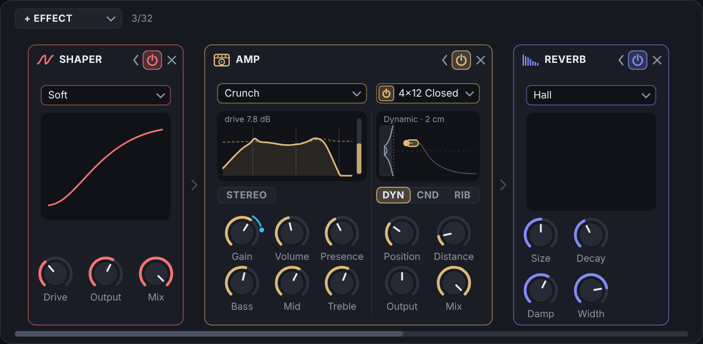
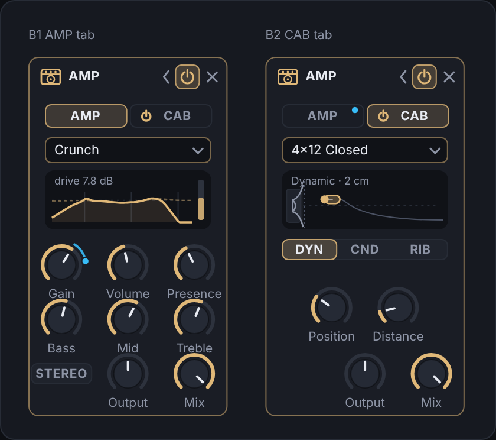
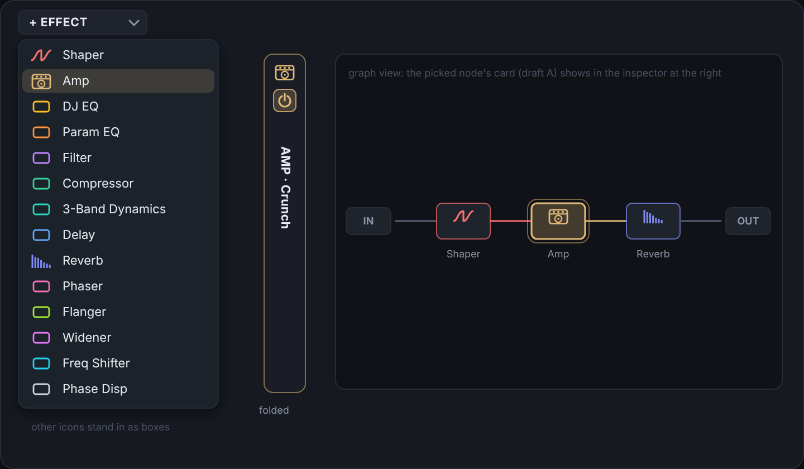
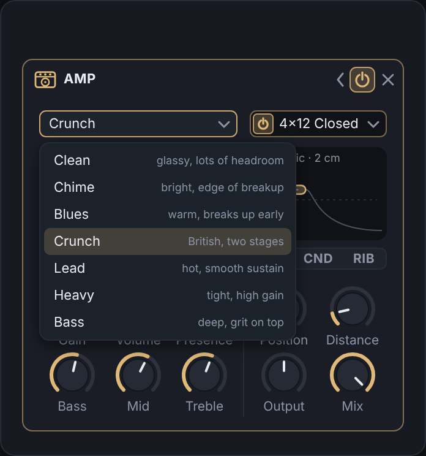
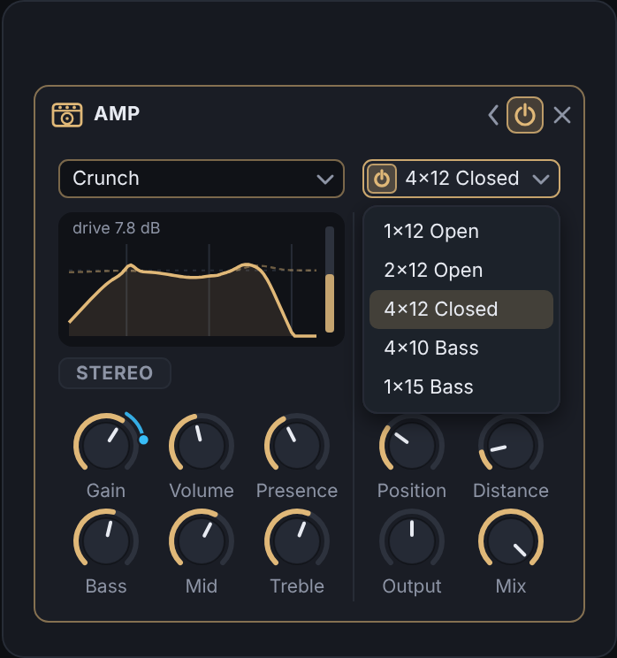
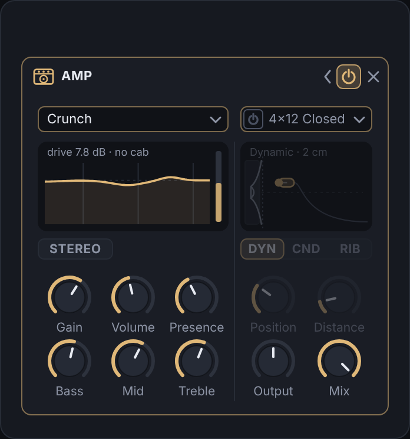

# Plan: the Amp effect

A guitar-amp effect for the effects line: a choice of amp models, each a preamp, a tone stack and a power amp, and
an optional cabinet emulation after them, as the amp devices DAWs ship do, though nothing here copies another
product's names, graphics or tunings. On an FM synth it does what an amp does to a guitar:
grit, compression, a midrange voice, and a speaker taking away the fizz.

UI drafts: [drafts.html](drafts.html) (open it in a browser), rendered at 2x as the PNGs beside it
(`NODE_PATH=$(npm root -g) node render.js` renders them again, with an installed Playwright and its Chromium).

| | |
| --- | --- |
|  | Draft A (recommended): a wide card, the amp on the left and the cabinet on the right |
|  | Draft B: a card of the usual width with AMP and CAB tabs |
|  | The list of effects, the folded card and the graph's node |

## 1. What it does

### Signal path

```
in ─┬─────────────────────────────────────────────────────────────────────────────── dry ─┐
    │                         ┌──────────────── 4x oversampled ────────────────┐          │
    └─ Stereo? (mono: L+R/2) ─┤ input HPF → preamp stages → tone stack →       ├─ DC ─ cab ─ Output ─ Mix ─ out
                              │ Presence → power amp (Volume, sag)             │   blocker  (optional)
                              └────────────────────────────────────────────────┘
```

- **Model** picks the amp: how many preamp stages, how they clip, the filters between them, the tone stack's
  circuit and the power amp's headroom and sag. Seven to begin with:

  | Model | Character | Preamp | Tone stack | Power amp |
  | --- | --- | --- | --- | --- |
  | Clean | glassy, lots of headroom | 1 stage, gentle | American, scooped | big headroom, little sag |
  | Chime | bright, edge of breakup | 1 stage, bright cap | Bright, treble forward | class A feel, early compression |
  | Blues | warm, breaks up early | 2 stages, loose low end | American, mids up | more sag |
  | Crunch | British, two stages | 2 stages | British | medium |
  | Lead | hot, smooth sustain | 3 stages, Miller cut between | British | medium, tighter |
  | Heavy | tight, high gain | 4 stages, input HPF at ~700 Hz | British, deeper scoop | tight, little sag |
  | Bass | deep, grit on top | 1 stage with a parallel clean low band | Active: Baxandall bass/treble + a mid bell | big headroom |

  The models', stacks', cabinets' and mics' names are plain words: no maker's or product's name appears in the
  plugin, its docs or its presets. The tone stacks are named for their sound: **American** (a scooped passive
  three-knob stack), **British** (a mid-forward one), **Bright** (a treble-forward one)
  and **Active** (the Bass model's).
- **Gain** (0–10, 5 to begin with): drive into the preamp, over each model's own range (Clean about 0–24 dB,
  Heavy about 12–54 dB).
- **Bass, Mid, Treble** (0–10, 5): the model's tone stack. In the passive stacks they interact, as in the real
  circuits (Mid at 0 scoops, all at 0 is nearly silent, which is why the stack is computed from its components rather
  than as three independent EQ bands).
- **Presence** (0–10, 0): a high shelf around 3–5 kHz into the power amp, as an amp's presence control (which works in
  its negative feedback) brightens the top.
- **Volume** (0–10, 5): drive into the power amp, the master volume of a master-volume amp. High Volume compresses
  and saturates the power stage, and the model's **sag** (an envelope follower lowering the headroom, ~5 ms down,
  ~150 ms back) makes it bloom. Not a param of its own: each model has its amount.
- **Output** (−24 to +12 dB, 0): the level after the cabinet. Each model is trimmed so that, at the default knobs and
  with the cabinet on, a sine at −12 dBFS comes out within 2 dB of its input level, so switching models compares the
  tone, not the loudness. As Gain rises the level rises less and less (the stages clip), roughly as the shaper's Link
  does on its own.
- **Mix** (0–100 %, 100): dry against wet, as the other effects' Mix.
- **Stereo** (off): off, the amp runs once, on the sum of both sides, and puts it out on both (an amp is mono, and
  this halves the cost); on, each side runs through its own amp (twice the CPU). The dry side of Mix stays stereo
  either way.

### Cabinet (optional)

- **Cab** (on to begin with): an amp's output without a speaker is harsh and fizzy, so a new Amp starts with it on.
  Off, the amp goes straight to Output, for use into another cabinet, a filter or the reverb.
- **Cab type**: 1x12 Open, 2x12 Open, 4x12 Closed, 4x10 Bass, 1x15 Bass. Open backs have a thinner, looser low end,
  closed backs a tighter, bigger one; the bass cabinets reach lower and roll off sooner.
- **Mic**: Dynamic (a presence peak around 5 kHz, a little low cut), Condenser (flatter, more top and air), Ribbon
  (dark and smooth, more low end). A choice of three under the cabinet's display.
- **Position** (0–100 %, 30 %): where the mic points, from the cone's center (bright, the dust cap's peak) to its edge
  (dark). Continuous, so it modulates, which a three-way switch wouldn't.
- **Distance** (1 cm – 1 m on a log curve, 2 cm): close in, the mic's proximity effect lifts the lows; farther away the
  lows even out and the room comes in: a few early reflections (1–8 ms, darkened), as a mic set back from a cabinet
  hears.

### Behavior shared with the other effects

- Every knob can be modulated (the effect is shared by all voices, so the LFOs and envelopes reach it through the
  newest voice, as with every effect). Levels and Mix ramp sample by sample; the tone stack's and cabinet's
  coefficients follow their knobs every 16 samples, interpolated, so a swept Treble or Position doesn't zipper.
- Switching Model, Cab type or Mic crossfades from the old setting to the new over 10 ms, running both meanwhile
  (as a split's slope change does), so it neither clicks nor dips. Switching the cabinet on or off crossfades too.
- Not given to hosts, like every effect's params: set and modulated from the editor.
- No latency: the oversampling uses the polyphase IIR half-bands the voices already use (nearly linear phase in the
  audible band). Its small phase shift and the cabinet's filters make a partial Mix comb a little against the dry
  sound; that is how a parallel amp behaves too, and Mix at 100 % has none of it.

## 2. DSP design

All of it in a new `src/amp.h` (pure, constexpr where it can be: the model and cabinet tables, the tone stack's
coefficients and the responses the editor draws) and the running part in `src/effects.cpp`, as the other effects.

### Oversampling

Effects run at the host rate, and cascaded clipping stages alias badly there. The amp runs its nonlinear part (input
filter, preamp, tone stack, power amp) at **4x**: up through two half-band interpolators, down through two
`HalfBand` decimators from `src/oversampler.h` (a `HalfBand` up-sampler is the same allpass pair run the other way;
add it there). The cabinet runs at the host rate after the decimators. Each stage's curve also uses the shapers'
first-order antiderivative anti-aliasing where it is cheap (`src/clipcurve.h` has the pattern). Fixed at 4x rather than
following the voices' oversampling setting: the setting is about voices, and an amp at 1x would alias at once.
`tests/quality.cpp` measures the aliasing (below) and decides whether 4x is enough for Heavy at full Gain on a high
note; 8x is the fallback for Heavy only.

### Preamp

Each stage is a triode-like stage:

1. a coupling high-pass (the interstage capacitor; 20–700 Hz by model and stage: the Heavy model's tight low end
   comes from these),
2. gain,
3. an asymmetric soft clip: `y = tanh(k(x + b)) − tanh(k·b)` with a bias `b`, the positive side (grid conduction)
   clipping harder, which gives the even harmonics,
4. a one-pole low-pass (the Miller capacitance, 6–12 kHz),
5. for the bright models, a high shelf across the gain (a bright cap or cathode bypass).

A model is a row of a constexpr table (`AmpModelSpec`): stage count, per stage the high-pass, gain range, bias,
curve hardness and low-pass; the tone stack kind and its component values; the power amp's headroom, sag amount and
presence corner; and the output trim.

### Tone stack

The passive stacks (American, British, Bright) are the classic three-knob tone stack circuit of the 1950s and 60s,
whose transfer function from its resistors, capacitors and pot positions is a known third-order analog filter (Yeh and
Smith's discretization of it, DAFx 2006). Each stack's component values are our own, chosen and tuned by ear on that
topology rather than copied from a particular amp's schematic. The coefficients come from the model's component
values and the knobs (with the pots' tapers: the bass pot log), through the bilinear transform with prewarping. It runs
as a third-order filter in transposed direct form II at the oversampled rate, its coefficients recomputed every 16
samples while a knob moves (and only then). The Bass model's stack is active: a Baxandall bass and treble shelf and a
mid bell at 500 Hz. `ampToneResponse()` gives the editor the same response for its display.

### Power amp

**Presence** shelf, then the Volume gain, then a symmetric push-pull curve (softer than the preamp's, a touch of
crossover shape at the lowest levels for the Chime model), with **sag**: an envelope follower on the output lowering
the stage's headroom by up to the model's amount (0–6 dB). A DC blocker after it, as the shaper effect has, for the
offset the asymmetric stages leave.

### Cabinet

A parametric model, about eight biquads at the host rate:

- a high-pass with a resonance (the speaker's low resonance, 70–120 Hz; open backs lower and broader),
- two or three peaks and dips in the low mids and the cone's breakup region (1–4 kHz),
- a steep low-pass (two biquads, 24 dB per octave, at 4–6 kHz for guitar cabinets, 3–4 kHz for bass ones),
- the mic: a peak and a low shelf (Dynamic: +4 dB at 5 kHz, low cut; Condenser: flatter, +2 dB air at 10 kHz; Ribbon:
  −3 dB at 8 kHz, low lift),
- Position moves the low-pass corner down (to about half) and the breakup peak down and lower as it goes from center
  to edge; Distance takes the proximity lift (a low shelf, +6 dB close, 0 far) away and fades in three early
  reflections (1.3, 3.1 and 7.7 ms, low-passed at 5 kHz) from about 20 cm on.

Every coefficient is interpolated between table rows for Position and Distance and smoothed as the tone stack's.
`ampCabResponse()` gives the editor the same response.

**Impulse responses, considered and left for later.** Convolution with measured IRs sounds the most real, but needs IRs
we may ship (our own measurements, or licensed ones), adds their size to the plugin and the browser demo, costs a
partitioned FFT convolution, and can't move the mic continuously without crossfading many IRs. The parametric
cabinet is the first step; a "Custom IR" cabinet type that loads a file could follow (it needs file handling and a path
in the state, as presets have).

**A separate Cabinet effect, considered.** Some DAWs have the cabinet as a device of its own. Built in, as asked, it is
one card and one place in the line and the amp sounds right on its own. The cabinet's code is its own class
(`AmpCab`), so a standalone Cabinet effect type would be a small change later if it is wanted (a cabinet after a
shaper, say).

### Telemetry

The drive meter on the card shows how far the stages saturate now: the input's peak times the gain against what
comes out, in dB, the most of the latest block, falling as the compressor's reduction does. It goes in the existing
per-slot `reduction_` array (band 0), which `sharedtelemetry.h` already hands the editor as `fxReduction`; no new
telemetry.

### Cost

At 4x the amp is a few dozen operations a sample per stage; with the cabinet's eight biquads it should come to well
under 1 % of a core at 48 kHz with Stereo off. `tests/quality.cpp` prints it with the other CPU figures.

## 3. Params and storage

New, all appended (every one of these lists is stored by number):

- `FxType::Amp` after `MultiDyn` (number 15).
- `enum class AmpModel { Clean, Chime, Blues, Crunch, Lead, Heavy, Bass, Count }`,
  `enum class AmpCab { Open1x12, Open2x12, Closed4x12, Bass4x10, Bass1x15, Count }`,
  `enum class AmpMic { Dynamic, Condenser, Ribbon, Count }`, each pinned with `numberedInOrder` static_asserts.
- `FxParam`, after `FlangerNegative`:

  | Field | Range | Default | Text |
  | --- | --- | --- | --- |
  | `AmpModel` | 0–6, stepped | Crunch | the model's name |
  | `AmpGain` | 0–1 | 0.5 | 0.0–10.0 |
  | `AmpBass` | 0–1 | 0.5 | 0.0–10.0 |
  | `AmpMid` | 0–1 | 0.5 | 0.0–10.0 |
  | `AmpTreble` | 0–1 | 0.5 | 0.0–10.0 |
  | `AmpPresence` | 0–1 | 0 | 0.0–10.0 |
  | `AmpVolume` | 0–1 | 0.5 | 0.0–10.0 |
  | `AmpOutput` | −24–12 dB | 0 | dB |
  | `AmpMix` | 0–1 | 1 | % |
  | `AmpStereo` | 0/1 | 0 | Off/On |
  | `AmpCabOn` | 0/1 | 1 | Off/On |
  | `AmpCab` | 0–4, stepped | 4x12 Closed | the cabinet's name |
  | `AmpMic` | 0–2, stepped | Dynamic | the mic's name |
  | `AmpMicPosition` | 0–1 | 0.3 | % (0 % the center) |
  | `AmpMicDistance` | 0–1, log 1 cm – 1 m | 2 cm | cm, m |

- `kFxFieldRuns` gets `{FxParam::AmpModel, FxParam::AmpMicDistance, FxType::Amp}`.

**Ids.** The first 16 slots' fields have three id ranges (80 at 1400 + 80·slot, 20 at 12000 + 20·slot, 40 at
25000 + 40·slot); 134 fields are used and the third range has room for 6 more. So:

- `AmpModel` … `AmpOutput` (fields 134–139) take the third range's last places: 25034–25039 + 40·slot.
- `AmpMix` … `AmpMicDistance` (9 fields) need a fourth range: **36000 + 20·slot** (36000–36308; nothing uses
  36000 up, the effects graph's last id being 35276). `SplitSection` has room for three ranges; it becomes a short list
  of `{fields, base, stride}` ranges, which `idOfIndex()`, `indexOfId()` and `maxParamId()` walk. Keep 11 places
  of that range spare for the next effect.
- The slots past the 16th have 200 places a slot at 26000 + 200·(slot − 16); 149 used.
- Pin them with the "effect slot param ids moved" static_assert. `idsRoundTrip()` already walks every param index
  (19,121 is still under its 24,000); its check that no range holds more fields than its stride walks the new list.

That adds 15 × 32 = 480 params (18,641 to 19,121). None is given to hosts, so the host lists, remote pages and the
VST3 units don't change. No state version bump: a state without these fields keeps their defaults, as the loader
does for any param it doesn't have. A preset the plugin saves grows by about 3 KB; factory presets are sparse and
don't change.

## 4. Editor

### The card (draft A, recommended)


1.75 card places wide (312 px; `fxSpan()` gets the case). The Param EQ and the 3-Band Dynamics take 1.5, but at 1.5
the amp's three knob columns would be 41 px apart and "Volume" and "Presence" run into each other (the first draft
did, at 264 px). Two columns, split by a faint line, in the order the sound goes through them:

- **Amp (left, 162 px):** the Model list (a `ListButton`, as the reverb's algorithm); the display: the tone's frequency
  response, through the cabinet when it is on (solid, filled) over the tone stack alone (faint, dashed), with
  "drive 7.8 dB" at its top left and the drive meter at its right edge; STEREO under it (a `Toggle`); Gain, Volume,
  Presence over Bass, Mid, Treble.
- **Cabinet (right, 112 px):** the cabinet's chip: a power symbol (`Toggle` on `AmpCabOn`) in a list button (the
  cabinet types), as the Param EQ's band chips put the power symbol in the chip; the display: the speaker seen from the
  side and the mic in front of it, which drags across the cone (Position, up) and away from it (Distance, right),
  "Dynamic · 2 cm" at its top left; DYN | CND | RIB under it (a `Choice`, as the flanger's polarity); Position and
  Distance over Output and Mix, where the sound leaves.
- With the cabinet off (A4), its display, mic switch and Position and Distance dim, as a switched-off operator's page
  does; Output and Mix stay lit. They still take edits and modulation.

| A2: model list | A3: cab list | A4: cabinet off |
| --- | --- | --- |
|  |  |  |

New in the editor:

- `Kind::AmpMic`, the mic on the cabinet's display: drags Position and Distance at once, as `PeqPoint` drags a band's
  frequency and gain; a double-click resets both. Each knob is still there for modulation.
- `View::paintAmp()` and `View::paintAmpCab()` for the two displays, drawing with existing `Canvas` calls (polylines,
  filled polygons, rounded rects), so no backend needs a new call.
- The model list shows each model's one-line character at its right (A2), dim; the list's rows are otherwise the
  reverb list's.
- The icon (`icons.cpp`): a combo amp from the front, a strip of three knobs over a speaker.
- A color of its own in each theme (`theme.h`, `fxTypes`, whose static_assert goes from 15 to 16): "tweed", a warm,
  desaturated gold (Midnight `#E0B878`), apart from the DJ EQ's amber and the Param EQ's orange. The other three
  themes take it in their own key (Graphite `#E8C98F`, Light `#9A6A1C`, Paper `#8C5A1E`), to be checked against
  their neighbors in the list.
- `kFxOffered`: Amp right after the Shaper (the distortion pair). The list then has 14 entries: from under
  + EFFECT it needs 365 of the panel's 372 px, which its static_assert checks; opened from a + of the graph it has a
  split after the effects and is moved inside the editor as now (a uishot check reads that it stays inside).
- Strings (`uistrings.inc`): `FxTitleAmp` ("AMP"), the param names ("Amp Model", "Amp Gain", …), the models', cabinets'
  and mics' names, the model notes, `LabelBass`, `LabelTreble`, `LabelPresence`, `LabelPosition`, `LabelDistance`,
  (STEREO is the phaser's and flanger's `SwitchStereo` already), `CaptionAmpDrive` ("drive {1} dB"), `CaptionAmpCab`
  ("{1} · {2}") and the tooltips.
- The folded card, the effects graph's node and the inspector come with the type (C). The inspector is 1.75 places
  wide when the amp's node is picked, and the graph's box takes what is left, as for the Param EQ.

### Draft B, the alternative


A card of the usual width with AMP and CAB tabs under the title row (the CAB tab carrying the cabinet's power symbol),
the knobs three to a row, Output and Mix in the same places on both tabs. It keeps the row as dense as it is now, and
the operator page has the tab conventions it needs (a dot on a hidden tab whose knob is modulated, a dragged depth
handle opening the tab it is held over). Against it: half the controls are always hidden, a modulation's ring on a
hidden knob can't be seen, and the cabinet's state is one click away. The effects show everything elsewhere (the
3-Band Dynamics fits 13 knobs on 1.5 places), so A fits the editor better.

## 5. Tests

Following the ground rules: engine behavior in `tests/smoke_host.cpp` or `tests/quality.cpp`, editor interactions in
`tools/uishot.cpp`.

**Smoke test** (Windows):

- the parameter table: the new fields' text round-trips at each end and just inside (the stepped lists by name,
  Distance in cm and m);
- an Amp on an A4: harmonics appear and grow with Gain, for every model; Heavy has more of them than Clean at the same
  knobs; the asymmetric stages give a 2nd harmonic;
- Bass and Treble move the low-to-high ratio the right way; Mid at 0 scoops the 500 Hz–1 kHz band against Mid at 10;
- the cabinet takes the top away (energy above 8 kHz at least 20 dB down with it on), Position toward the edge
  darker than the center, Distance far bringing reflections in (an impulse's echo at 7.7 ms);
- Stereo off puts the same on both sides for a sound only on the left; on, the right stays silent for it;
- Mix at 0 leaves the input as it was; Output moves the level by its dB;
- a new Amp starts with the cabinet on, Crunch, 4x12 Closed and Dynamic.

**Audio quality** (Linux and Windows):

- aliasing (the energy off the harmonics, 20 Hz–20 kHz) of Heavy at full Gain and Volume on a C7, and of every model
  at its default knobs, below a threshold set from the shaper's;
- the level of a −12 dBFS sine at the default knobs within 2 dB of the input for every model, cabinet on;
- no click when Model, Cab type or Mic is switched, or the cabinet switched on and off, in whole blocks and in single
  frames (each period's peak within 10 %, as the effects graph's edits are checked);
- no zipper noise from an LFO on Gain, Treble, Presence, Position and Output;
- no DC out of a model with asymmetric stages, and the effect running on until its DC blocker has settled;
- a voice into the amp at 0 Hz input staying silent, and an input that isn't a number not poisoning the state
  (the shaper's check);
- the CPU cost, Stereo off and on.

**UI snapshots** (Linux and Windows): the card rendered in each theme; the Model, Cab and Mic lists picking, each an
undo step; the cabinet's power symbol switching it and its controls dimming (read off the rendered pixels); the mic
dragged on its display moving Position and Distance in one undo step, and double-clicked back; the drive meter
following the telemetry (read off the pixels); the display's curve moving with Treble and with Position (read off
the pixels); the list of effects with the Amp's icon; the card in the graph's inspector, the graph's box narrower
beside it than beside a usual card.

**VST3 smoke test:** nothing new to check (no new host params), but it runs with the larger param table.

## 6. Steps

Each step builds and keeps `ctest` green (`./build.sh` on Linux covers the engine, the editor, quality and uishot;
`build.ps1` on Windows the rest).

1. **Params.** `FxType::Amp`, the three enums, the 15 fields and their table rows (names, ranges, defaults, text), the
   id ranges (`SplitSection` as a list), the static_asserts, `fxName()`, the strings, the theme colors, the icon,
   `kFxOffered`, and a plain card (the knobs in rows) so the type is usable. `runAmp()` passes the sound through.
   Smoke: the table and text round-trips.
2. **Amp DSP.** `src/amp.h` (model table, stage, tone stack, power amp, sag), the 4x up- and down-sampling, `runAmp()`
   with Stereo, Output and Mix, the drive telemetry, the crossfade on a model switch. Quality: aliasing, levels,
   clicks, zipper, DC, CPU. Smoke: harmonics, tone controls, Stereo, Mix. Tune the seven models by ear in
   `fmvibe-uihost` and Bitwig (by hand: neither is started by an agent), then fix each model's output trim from the
   level check.
3. **Cabinet DSP.** `AmpCab`: the cabinet and mic tables, Position and Distance, the reflections, the crossfades on a
   cabinet or mic switch and on the cabinet's switch. Quality and smoke checks for it.
4. **Card.** Draft A: the layout in `layout.h`, `paintAmp()`, `paintAmpCab()`, `Kind::AmpMic`, the chip with the power
   symbol, the model list's notes, the dimming. uishot replays.
5. **Docs and a preset.** The Amp in `docs/features.md` (the effects list and the editor's card), the counts in
   `AGENTS.md` (18,641 params becomes 19,121; the test lists), and a factory preset showing it off, appended to
   `presets/factory.txt`. Remove this plan's entry from `TODO.md`.

## 7. Open questions

1. **Draft A or B?** A is recommended.
2. **The models**: these seven, fewer, or others (a Fuzz)? Names?
3. **The cabinets**: these five? A "Custom IR" type later?
4. **The cabinet on to begin with?** Recommended, since the amp alone is harsh.
5. **Oversampling**: a fixed 4x, or a choice on the card (2x / 4x / 8x) for CPU against aliasing?
6. **The color**: tweed gold, or another the four themes have room for?
7. **A Cabinet effect of its own as well**, now or later?
